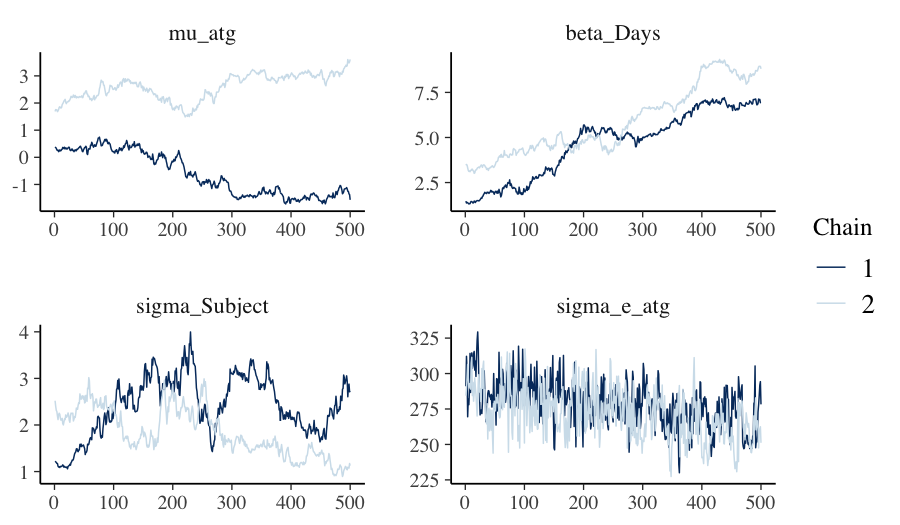

# 1. Why Bayesian mixed models?

Restricted maximum likelihood (REML) — the workhorse behind `lme4`,
`nlme`, and ASReml — returns a single point estimate of each variance
component plus a Wald-style standard error. Two situations make this
summary uncomfortable.

- **Small group counts.** When the number of clusters is modest
  (fewer than roughly thirty), the sampling distribution of the
  variance-component estimator has a long right tail. The Wald
  interval is informative only near the centre, where the posterior
  is approximately quadratic.
- **Boundary problems.** A maximum-likelihood variance estimate can
  land on zero. That is *uninformative*: the data may not have ruled
  out a small-but-nonzero variance, but the boundary collapses both
  the estimate and the uncertainty.

A Bayesian fit replaces the point estimate with the *full posterior
distribution*. You see directly how much mass the data place near
zero, and you can propagate that uncertainty into derived quantities
— predictions, contrasts, best linear unbiased predictors (BLUPs) —
without leaning on quadratic approximations.

`bayesreml` is built around one principle: switching from REML to
Bayesian inference should not change the formula you write. If you
can express the model in ASReml syntax, the call

```r
bayesreml(fixed = y ~ ..., random = ~ ..., rcov = ~ ..., data = ...)
```

fits it. If you prefer brms-style notation, the call

```r
fb(y ~ ... + (1 | g), data = ...)
```

does the same. Both routes go through a shared internal model
representation (IR), and the same fitted object supports `summary()`,
`predict()`, `emmeans::emmeans()`, `marginaleffects::predictions()`,
and the `bayesplot::*` family.

# 2. Installation

`bayesreml` requires R 4.1.0 or later. Inference happens through one of
two engines.

- **greta** (default). A TensorFlow-backed Hamiltonian Monte Carlo
  (HMC) sampler. Covers every term type in the asreml-format domain-
  specific language (DSL).
- **INLA** — integrated nested Laplace approximation (Rue et al.,
  2009). A deterministic Laplace approximation over the latent
  Gaussian model (LGM) class. Substantially faster than HMC, but
  with a narrower scope.

Install both:

```r
# greta and its TensorFlow backend
install.packages("greta")
greta::install_greta_deps()      # one-time Python/TF setup

# INLA — not on CRAN; from the INLA team's repository
install.packages(
  "INLA",
  repos = c(getOption("repos"),
            INLA = "https://inla.r-inla-download.org/R/stable")
)

# bayesreml itself
install.packages("bayesreml")
# or, while on GitHub:
# remotes::install_github("AAGI-AUS/bayesreml")
```

A handful of companion packages enrich the post-fit experience and are
introduced in subsequent vignettes:

```r
install.packages(c("emmeans", "marginaleffects", "bayesplot",
                   "posterior", "loo", "effectsize", "agridat"))
```

If INLA cannot be installed on your platform, the package degrades
gracefully. The greta backend remains available; INLA-only paths emit
clear messages and you simply do without `triangulate()` for now.

# 3. Your first model

We use `lme4::sleepstudy` (Belenky et al., 2003): reaction times for
eighteen subjects across ten days of restricted sleep. The natural
mixed model has a fixed linear time trend and a random subject
intercept.


``` r
library(bayesreml)
data(sleepstudy, package = "lme4")
str(sleepstudy)
#> 'data.frame':	180 obs. of  3 variables:
#>  $ Reaction: num  250 259 251 321 357 ...
#>  $ Days    : num  0 1 2 3 4 5 6 7 8 9 ...
#>  $ Subject : Factor w/ 18 levels "308","309","310",..: 1 1 1 1 1 1 1 1 1 1 ...
```

We start with the brms-style entry, `fb()`. The formula reads exactly
as in `lme4::lmer()`: `Reaction ~ Days + (1 | Subject)`.


``` r
fit_greta <- fb(
  Reaction ~ Days + (1 | Subject),
  data      = sleepstudy,
  backend   = "greta",
  n_samples = 500,
  warmup    = 500,
  chains    = 2,
  verbose   = FALSE
)
fit_greta
#> Bayesian mixed model  [bayesreml]
#> ------------------------------------------------------- 
#>   Fixed  : Reaction ~ Days + (1 | Subject) 
#>   Family : gaussian ( identity link )
#>   MCMC   : 2 chain(s) x 500 samples (warmup = 500 ) -- 3.2 sec
#>   Params : 4 monitored; 2 fixed, 1 random terms
#>   Max Rhat: 19.84  [!] 
#>   Min ESS: 3 
#> ------------------------------------------------------- 
#>   $glm    -- GLM-compatible (summary, emmeans, etc.)
#>   $greta  -- native greta (draws, model, calculate)
#>   $extras -- diagnostics, BLUPs, variance components
```

### A note on random *intercepts* versus random *slopes*

The same data also supports `Reaction ~ Days + (Days | Subject)` — a
per-subject slope on top of the intercept. In v0.1, `fb()` accepts
random intercepts only; random slopes raise a clear refusal:

```r
fb(Reaction ~ Days + (Days | Subject), data = sleepstudy,
   backend = "greta")
#> Error: v0.1 brms ingest only supports random intercepts (1 | g) or
#>   (1 || g). Found: (Days | Subject). Random slopes will be added in
#>   subsequent iterations.
```

The asreml-format entry `bayesreml()` covers a wider term-type surface
(factor-analytic, unstructured, autoregressive, pedigree, …) and is
documented in the *asreml-shaped formulas* vignette; the
*hierarchical models* vignette covers the random-slope case. For the
remainder of this introduction we keep the random intercept.

# 4. What is inside a fit?

`fit_greta` is an object of class `bayesreml`. The default print method
is concise; `summary()` gives the full posterior digest:


``` r
summary(fit_greta)
#> Bayesian mixed model summary  [bayesreml]
#> ============================================================ 
#>   Fixed  : Reaction ~ Days + (1 | Subject) 
#>   Family : gaussian / identity 
#>   N = 180 , chains = 2 , samples = 500 
#> 
#> -- Fixed effects (posterior)  --------------------------------- 
#>             Estimate Post.SD    2.5%  97.5%
#> (Intercept)   0.9898  1.7238 -1.5923 3.1774
#> Days          5.2598  1.9587  1.5959 9.0817
#> 
#> -- Variance components  -------------------------------------- 
#>       Component Estimate      SD     2.5%    97.5%
#> 1 sigma_Subject   2.1285  0.6408   1.0862   3.3197
#> 2   sigma_e_atg 275.3407 17.0125 243.8744 309.0469
#> 
#> -- Convergence  --------------------------------------------- 
#>   Rhat range: 1.118 - 19.84 
#>   ESS  range: 3 - 94 
#>   Run time  : 3.2 sec
```

The output is laid out in three blocks.

1. **Fixed effects.** Posterior mean, posterior standard deviation
   (SD), and equal-tailed 95 % credible interval for each design-
   matrix column. Here `(Intercept)` is the baseline reaction time
   and `Days` is the per-day slope.
2. **Variance components.** The Subject-level SD and the residual SD,
   both on the response scale.
3. **Sampler diagnostics.** Effective sample size (ESS) and the
   rank-normalised $\widehat{R}$ (Vehtari et al., 2021). A
   trustworthy fit has ESS ≥ 400 and $\widehat{R} \le 1.01$ on
   every parameter.

A density plot of the posteriors is one line:


``` r
plot(fit_greta)
```



### Variance-component priors

When you call `fb()` or `bayesreml()` without specifying a prior,
`bayesreml` 0.1.x announces the default it uses on every random-effect
SD and the residual SD: a *penalised-complexity* (PC) prior (Simpson
et al., 2017) keyed to the response scale. The deprecation message
fires once per session, naming the upper-tail bound and the cited
literature. The default applies only when both `prior` and the legacy
scalar `prior_vc_sd` are absent; passing `prior_vc_sd` preserves the
legacy lognormal default verbatim. The *priors and regularisation*
vignette articulates the choice in detail and shows you how to set
priors deliberately.

# 5. The same model on a second engine

`fit_greta` is a Markov chain Monte Carlo (MCMC) fit; INLA runs a
fundamentally different algorithm — a Laplace approximation over a
small set of hyperparameters — and finishes almost instantly:


``` r
fit_inla <- fb(
  Reaction ~ Days + (1 | Subject),
  data    = sleepstudy,
  backend = "inla",
  verbose = FALSE
)
summary(fit_inla)
#> Bayesian fit summary  [bayesreml_inla / INLA backend]
#> ------------------------------------------------------------ 
#> Fixed effects:
#>                 mean     sd 0.025quant 0.5quant 0.975quant     mode kld
#> (Intercept) 251.4782 6.6504   238.4256 251.4778   264.5327 251.4778   0
#> Days         10.4510 1.2454     8.0062  10.4511    12.8954  10.4511   0
#> 
#> Hyperparameters:
#>                                                 mean           sd   0.025quant
#> Precision for the Gaussian observations 4.000000e-04 0.000000e+00 4.000000e-04
#> Precision for Subject                   6.243795e+14 1.797676e+14 3.967204e+14
#>                                             0.5quant   0.975quant         mode
#> Precision for the Gaussian observations 4.000000e-04 5.000000e-04 4.000000e-04
#> Precision for Subject                   5.860555e+14 1.084661e+15 4.962496e+14
#> 
#> Random effects:
#>   groups: Subject
#> ------------------------------------------------------------
```

Both engines have approximated the same posterior. *How well do they
agree?* That is the question `triangulate()` answers.


``` r
prec_to_sd <- function(x) 1 / sqrt(x)

# `inla.posterior.sample` can be flaky under restricted-process
# environments (e.g., CRAN's vignette re-render). Wrap so a failure
# is informative rather than fatal.
tri <- tryCatch(
  triangulate(
    fit_greta, fit_inla,
    transform_b = list(
      "Precision for Subject"                   = prec_to_sd,
      "Precision for the Gaussian observations" = prec_to_sd
    ),
    name_map = c(
      "(Intercept):1"                           = "intercept",
      "Days:1"                                  = "beta_Days",
      "Precision for Subject"                   = "sigma_Subject",
      "Precision for the Gaussian observations" = "sigma_e"
    )
  ),
  error = function(e) {
    message("triangulate() unavailable in this session: ", conditionMessage(e))
    NULL
  }
)
if (!is.null(tri)) tri
#> <triangulate_result>
#>   source_a: greta
#>   source_b: inla
#>   n_common: 2
#>   only_a:   2 parameters (mu_atg, sigma_e_atg)
#>   only_b:   200 parameters (Predictor:1, Predictor:2, Predictor:3, Predictor:4, Predictor:5, ...)
#> 
#> Metrics (per common parameter):
#>           param mean_a mean_b mean_diff   sd_a   sd_b     sd_ratio q025_diff
#> 1     beta_Days 5.2598  10.48   -5.2202 1.9587 1.2581 1.556900e+00   -6.4839
#> 2 sigma_Subject 2.1285   0.00    2.1285 0.6408 0.0000 7.073169e+07    1.0862
#>   q975_diff wasserstein_1 rhat_means
#> 1   -3.8851        5.2202     2.4553
#> 2    3.3197        2.1262     3.4690
```

The output is a per-parameter readout. The two columns to focus on
first are `wasserstein_1` — a scale-respecting distance between the
two posterior marginals — and `rhat_means`, a rank-normalised
$\widehat{R}$ applied across the two engines' posterior means. Values
near unity indicate agreement.

For a well-behaved Gaussian random-intercept model the two engines
should agree to at least the second decimal on the fixed effects and
within a few percent on the variance components. Disagreement of more
than 0.1 SD on any parameter is a *finding*, not a bug — the
*cross-engine triangulation* vignette walks through the eight
common patterns and the protocol for diagnosing each.

# 6. Where to next?

The remaining vignettes are organised by topic, not by engine. A
suggested reading order:

| Vignette | What it covers |
|---|---|
| Foundational regression | one- and two-way fixed effects; splines; comparison with `lm()` |
| Hierarchical models | random intercepts, nested and crossed effects, Poisson and binomial generalised linear mixed models (GLMMs) |
| asreml-shaped formulas | the full term-type catalogue: `factor`, `fa`, `us`, `at`, `ar1`, `vm`, `ped`, … |
| Priors and regularisation | the `fb_prior()` DSL, the PC default, prior-predictive checks |
| Cross-engine triangulation | the signature feature: when engines disagree, what it means, what to do |
| LGM feasibility | what `lgm_gate()` accepts, what it refuses, and how to override |
| Downstream analysis | `emmeans`, `marginaleffects`, `bayesplot`, `loo` |
| Backend internals | the IR, `emit_greta`, `emit_inla`, capability gating |
| Structured covariance | `us`, `fa`, `at`, design variance components |
| Spatio-temporal | AR1, geostatistical, temporal correlation |
| Multi-environment trials and genomics | MET, genotype-by-environment interaction (GxE), GBLUP (genomic BLUP) |

# 7. Pitfalls

**Never `R CMD INSTALL` while `bayesreml` is loaded.** R's lazy-load
database can be corrupted when a package is overwritten under a live
session. Restart R first.

**Convergence is not correctness.** A passing $\widehat{R}$ tells you
that the chains explored the same posterior; it does not tell you
whether that posterior is the right one for the problem. Posterior-
predictive checks (Gelman, Meng, & Stern, 1996) and the cross-engine
triangulation vignette address that distinction.

**The PC default is not always what you want.** The default scales
the prior to the observed response. If you have strong external
information about a variance component (e.g., a known measurement-
error magnitude), set it explicitly via `fb_prior()`. If you are
reproducing a published analysis that used a different prior, use
that prior.

**INLA's scope is narrower than greta's.** Random slopes, structured
covariance models, finite mixtures, and a few non-Gaussian families
fall outside the LGM class. `bayesreml` detects these structurally
via `lgm_gate()` and either routes to greta or refuses with a
structured message that names the rule violated.

# 8. Active prompts

Try the following while the package is loaded:

1. Re-fit `fit_greta` with `chains = 4` and `n_samples = 1000`. How do
   the ESS and $\widehat{R}$ values change? Does the posterior mean of
   `Days` shift?
2. Inspect `fit_greta$extras$code`: this is the literal greta program
   that bayesreml generated. Compare it with the program generated for
   `bayesreml(fixed = Reaction ~ Days, random = ~ Subject,
   data = sleepstudy, ...)`.
3. Pass `prior_vc_sd = 1` to `fb()` and refit. The deprecation message
   disappears (you have opted into the legacy lognormal). Does the
   posterior on `sigma_Subject` change appreciably?

# 9. Session information


``` r
sessionInfo()
#> R version 4.5.2 (2025-10-31)
#> Platform: aarch64-apple-darwin20
#> Running under: macOS Tahoe 26.3.1
#> 
#> Matrix products: default
#> BLAS:   /System/Library/Frameworks/Accelerate.framework/Versions/A/Frameworks/vecLib.framework/Versions/A/libBLAS.dylib 
#> LAPACK: /Library/Frameworks/R.framework/Versions/4.5-arm64/Resources/lib/libRlapack.dylib;  LAPACK version 3.12.1
#> 
#> locale:
#> [1] C.UTF-8/C.UTF-8/C.UTF-8/C/C.UTF-8/C.UTF-8
#> 
#> time zone: Australia/Adelaide
#> tzcode source: internal
#> 
#> attached base packages:
#> [1] stats     graphics  grDevices utils     datasets  methods   base     
#> 
#> other attached packages:
#> [1] bayesplot_1.15.0     emmeans_2.0.2        bayesreml_0.1.0.9000
#> 
#> loaded via a namespace (and not attached):
#>   [1] tidyselect_1.2.1       dplyr_1.2.1            farver_2.1.2          
#>   [4] tensorflow_2.20.0      loo_2.9.0              S7_0.2.2              
#>   [7] tensorA_0.36.2.1       INLA_25.10.19          TH.data_1.1-5         
#>  [10] bayestestR_0.17.0      digest_0.6.39          estimability_1.5.1    
#>  [13] lifecycle_1.0.5        sf_1.1-0               survival_3.8-3        
#>  [16] processx_3.9.0         magrittr_2.0.5         posterior_1.7.0       
#>  [19] compiler_4.5.2         rlang_1.2.0            progress_1.2.3        
#>  [22] tools_4.5.2            data.table_1.18.2.1    sn_2.1.3              
#>  [25] knitr_1.51             labeling_0.4.3         prettyunits_1.2.0     
#>  [28] mnormt_2.1.2           classInt_0.4-11        reticulate_1.45.0     
#>  [31] plyr_1.8.9             RColorBrewer_1.1-3     multcomp_1.4-29       
#>  [34] abind_1.4-8            KernSmooth_2.23-26     numDeriv_2016.8-1.1   
#>  [37] withr_3.0.2            stats4_4.5.2           grid_4.5.2            
#>  [40] datawizard_1.3.0       xtable_1.8-8           e1071_1.7-17          
#>  [43] future_1.70.0          ggplot2_4.0.3          ggridges_0.5.7        
#>  [46] globals_0.19.1         scales_1.4.0           MASS_7.3-65           
#>  [49] dichromat_2.0-0.1      insight_1.4.6          cli_3.6.6             
#>  [52] mvtnorm_1.3-6          crayon_1.5.3           generics_0.1.4        
#>  [55] otel_0.2.0             reshape2_1.4.5         parameters_0.28.3     
#>  [58] tfruns_1.5.4           DBI_1.3.0              proxy_0.4-29          
#>  [61] stringr_1.6.0          splines_4.5.2          parallel_4.5.2        
#>  [64] effectsize_1.0.2       matrixStats_1.5.0      base64enc_0.1-6       
#>  [67] marginaleffects_0.32.0 vctrs_0.7.3            Matrix_1.7-4          
#>  [70] sandwich_3.1-1         jsonlite_2.0.0         greta_0.5.1           
#>  [73] callr_3.7.6            hms_1.1.4              listenv_0.10.1        
#>  [76] units_1.0-1            glue_1.8.1             parallelly_1.47.0     
#>  [79] codetools_0.2-20       distributional_0.7.0   stringi_1.8.7         
#>  [82] gtable_0.3.6           tibble_3.3.1           pillar_1.11.1         
#>  [85] R6_2.6.1               fmesher_0.7.0          evaluate_1.0.5        
#>  [88] lattice_0.22-7         png_0.1-9              backports_1.5.1       
#>  [91] tfautograph_0.3.2      class_7.3-23           MatrixModels_0.5-4    
#>  [94] Rcpp_1.1.1-1.1         checkmate_2.3.4        coda_0.19-4.1         
#>  [97] whisker_0.4.1          xfun_0.57              zoo_1.8-15            
#> [100] pkgconfig_2.0.3
```

# References

Belenky, G., Wesensten, N. J., Thorne, D. R., Thomas, M. L., Sing,
H. C., Redmond, D. P., Russo, M. B., & Balkin, T. J. (2003). Patterns
of performance degradation and restoration during sleep restriction
and subsequent recovery: A sleep dose-response study. *Journal of
Sleep Research*, 12(1), 1–12.

Bates, D., Mächler, M., Bolker, B., & Walker, S. (2015). Fitting
linear mixed-effects models using lme4. *Journal of Statistical
Software*, 67(1), 1–48.

Gelman, A., Meng, X.-L., & Stern, H. (1996). Posterior predictive
assessment of model fitness via realized discrepancies. *Statistica
Sinica*, 6(4), 733–760.

Rue, H., Martino, S., & Chopin, N. (2009). Approximate Bayesian
inference for latent Gaussian models by using integrated nested
Laplace approximations. *Journal of the Royal Statistical Society:
Series B*, 71(2), 319–392.

Simpson, D., Rue, H., Riebler, A., Martins, T. G., & Sørbye, S. H.
(2017). Penalising model component complexity: A principled,
practical approach to constructing priors. *Statistical Science*,
32(1), 1–28.

Vehtari, A., Gelman, A., Simpson, D., Carpenter, B., & Bürkner, P.-C.
(2021). Rank-normalization, folding, and localization: An improved
$\widehat{R}$ for assessing convergence of MCMC. *Bayesian Analysis*,
16(2), 667–718.
