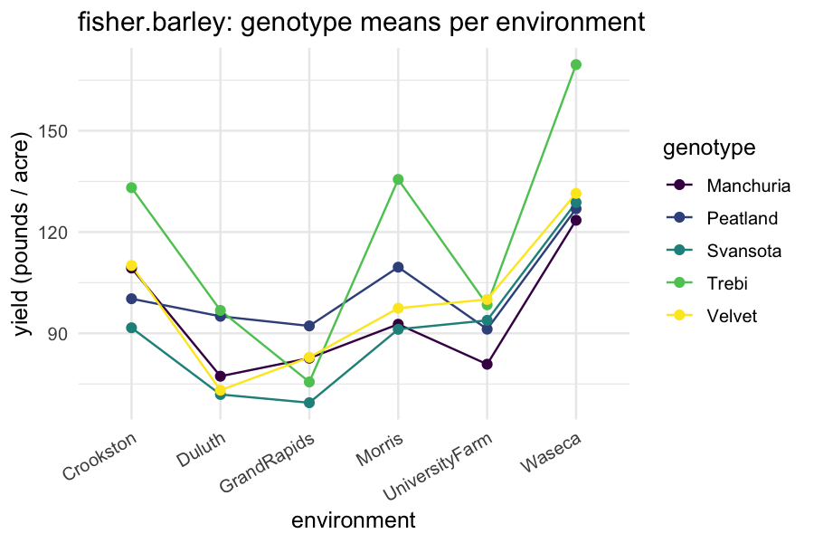
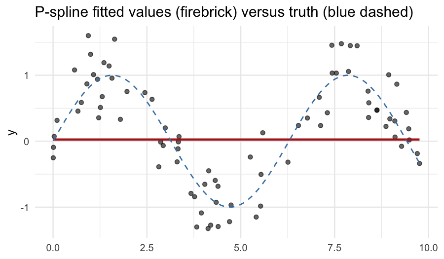

# 1. Why start with regression?

Linear regression is the simplest case `bayesreml` handles. Starting
here makes three things explicit before the more elaborate models
appear:

1. The *fixed effects* layer of every subsequent model is a regression
   model on its own.
2. The Bayesian summary of a regression — posterior on each
   coefficient, posterior on the residual standard deviation — is the
   pattern repeated, parameter for parameter, in every richer model.
3. Splines, which sit at the boundary between fixed and random
   effects, are the natural bridge to the *hierarchical models*
   vignette.

# 2. One-way analysis of variance: `PlantGrowth`

`datasets::PlantGrowth` records the dried weight of plants under three
treatment conditions: control, treatment 1, treatment 2. The natural
model is a one-way ANOVA — fixed effect for the three-level factor.


``` r
library(bayesreml)
data(PlantGrowth)
str(PlantGrowth)
#> 'data.frame':	30 obs. of  2 variables:
#>  $ weight: num  4.17 5.58 5.18 6.11 4.5 4.61 5.17 4.53 5.33 5.14 ...
#>  $ group : Factor w/ 3 levels "ctrl","trt1",..: 1 1 1 1 1 1 1 1 1 1 ...
```

Fit the same model on both backends:


``` r
fit_g <- fb(weight ~ group, data = PlantGrowth, backend = "greta",
            n_samples = 500, warmup = 500, chains = 2, verbose = FALSE)
summary(fit_g)
#> Bayesian mixed model summary  [bayesreml]
#> ============================================================ 
#>   Fixed  : weight ~ group 
#>   Family : gaussian / identity 
#>   N = 30 , chains = 2 , samples = 500 
#> 
#> -- Fixed effects (posterior)  --------------------------------- 
#>             Estimate Post.SD    2.5%   97.5%
#> (Intercept)   2.4159  5.8056 -7.3196 13.0499
#> groupctrl     2.6227  5.8030 -8.2050 12.4618
#> grouptrt1     2.2614  5.7941 -8.2568 12.1195
#> grouptrt2     3.1086  5.7976 -7.5483 12.8833
#> 
#> -- Variance components  -------------------------------------- 
#>     Component Estimate     SD   2.5% 97.5%
#> 1 sigma_e_atg   0.6451 0.0852 0.5116 0.837
#> 
#> -- Convergence  --------------------------------------------- 
#>   Rhat range: 1.007 - 1.234 
#>   ESS  range: 6 - 428 
#>   Run time  : 2.2 sec
```


``` r
fit_i <- fb(weight ~ group, data = PlantGrowth, backend = "inla",
            verbose = FALSE)
summary(fit_i)
#> Bayesian fit summary  [bayesreml_inla / INLA backend]
#> ------------------------------------------------------------ 
#> Fixed effects:
#>               mean     sd 0.025quant 0.5quant 0.975quant   mode kld
#> (Intercept)  5.032 0.2030     4.6311    5.032      5.433  5.032   0
#> grouptrt1   -0.371 0.2871    -0.9380   -0.371      0.196 -0.371   0
#> grouptrt2    0.494 0.2871    -0.0731    0.494      1.061  0.494   0
#> 
#> Hyperparameters:
#>                                           mean     sd 0.025quant 0.5quant
#> Precision for the Gaussian observations 2.5817 0.6943       1.41   2.5191
#>                                         0.975quant   mode
#> Precision for the Gaussian observations     4.1152 2.3926
#> 
#> Random effects:
#>   (none)
#> ------------------------------------------------------------
```

The fixed-effect block reports the baseline (control) mean as the
intercept, and the deviations of `trt1` and `trt2` from baseline.
The residual standard deviation block reports the within-group spread.

A reference fit with `lm()`:


``` r
summary(lm(weight ~ group, data = PlantGrowth))
#> 
#> Call:
#> lm(formula = weight ~ group, data = PlantGrowth)
#> 
#> Residuals:
#>     Min      1Q  Median      3Q     Max 
#> -1.0710 -0.4180 -0.0060  0.2627  1.3690 
#> 
#> Coefficients:
#>             Estimate Std. Error t value Pr(>|t|)    
#> (Intercept)   5.0320     0.1971  25.527   <2e-16 ***
#> grouptrt1    -0.3710     0.2788  -1.331   0.1944    
#> grouptrt2     0.4940     0.2788   1.772   0.0877 .  
#> ---
#> Signif. codes:  0 '***' 0.001 '**' 0.01 '*' 0.05 '.' 0.1 ' ' 1
#> 
#> Residual standard error: 0.6234 on 27 degrees of freedom
#> Multiple R-squared:  0.2641,	Adjusted R-squared:  0.2096 
#> F-statistic: 4.846 on 2 and 27 DF,  p-value: 0.01591
```

The frequentist least-squares estimates and the Bayesian posterior
means agree to about the second decimal — exactly as expected for a
linear model with weakly informative priors and a moderate sample
size.

# 3. Multiple regression with two factors: `fisher.barley`

`agridat::fisher.barley` (Fisher, 1935) is a small classic: barley
yield in pounds per acre for five varieties grown at six locations
across two years. We model yield as additive in genotype and
environment.


``` r
data(fisher.barley, package = "agridat")
str(fisher.barley)
#> 'data.frame':	60 obs. of  4 variables:
#>  $ yield: num  81 80.7 146.6 100.4 82.3 ...
#>  $ gen  : Factor w/ 5 levels "Manchuria","Peatland",..: 1 1 1 1 1 1 1 1 1 1 ...
#>  $ env  : Factor w/ 6 levels "Crookston","Duluth",..: 5 5 6 6 4 4 1 1 3 3 ...
#>  $ year : int  1931 1932 1931 1932 1931 1932 1931 1932 1931 1932 ...
```


``` r
fit_barley <- fb(
  yield ~ gen + env, data = fisher.barley,
  backend = "inla", verbose = FALSE
)
summary(fit_barley)
#> Bayesian fit summary  [bayesreml_inla / INLA backend]
#> ------------------------------------------------------------ 
#> Fixed effects:
#>                       mean     sd 0.025quant 0.5quant 0.975quant     mode kld
#> (Intercept)       101.6767 7.2897    87.3207 101.6832   115.9955 101.6831   0
#> genPeatland         7.0304 7.5083    -7.7920   7.0478    21.7529   7.0473   0
#> genSvansota        -4.0325 7.5069   -18.8346  -4.0212    10.7045  -4.0215   0
#> genTrebi           22.2146 7.5114     7.3622  22.2403    36.9192  22.2396   0
#> genVelvet           3.7737 7.5078   -11.0426   3.7894    18.5004   3.7889   0
#> envDuluth         -23.7462 8.0970   -39.5746 -23.7808    -7.7192 -23.7800   0
#> envGrandRapids    -25.9439 8.0978   -41.7699 -25.9799    -9.9112 -25.9790   0
#> envMorris          -2.0875 8.0906   -17.9430  -2.1084    13.8874  -2.1079   0
#> envUniversityFarm -14.0591 8.0938   -29.8988 -14.0875     1.9439 -14.0868   0
#> envWaseca          27.5329 8.0870    11.6304  27.5309    43.4469  27.5308   0
#> 
#> Hyperparameters:
#>                                           mean    sd 0.025quant 0.5quant
#> Precision for the Gaussian observations 0.0028 5e-04     0.0018   0.0027
#>                                         0.975quant   mode
#> Precision for the Gaussian observations     0.0039 0.0026
#> 
#> Random effects:
#>   (none)
#> ------------------------------------------------------------
```

The two factor blocks are reported relative to the (alphabetically
first) baseline level of each. To get *marginal means* per genotype
and per environment, use `emmeans` — see the *downstream analysis*
vignette.

A standard exploratory plot of the cell means:


``` r
library(ggplot2)
ggplot(fisher.barley,
       aes(x = env, y = yield, group = gen, colour = gen)) +
  geom_line(stat = "summary", fun = mean) +
  geom_point(stat = "summary", fun = mean, size = 2) +
  scale_colour_viridis_d() +
  theme_minimal(base_size = 12) +
  theme(axis.text.x = element_text(angle = 30, hjust = 1)) +
  labs(x = "environment", y = "yield (pounds / acre)",
       colour = "genotype",
       title = "fisher.barley: genotype means per environment")
```



# 4. Continuous predictors with `Days`

Most applied regressions involve one or more continuous predictors.
We use `lme4::sleepstudy` again — but this time we ignore the
subject grouping and fit a pooled regression of reaction time on
days of sleep restriction. The *hierarchical models* vignette shows
how the random-intercept fit improves on this pooled fit.


``` r
data(sleepstudy, package = "lme4")
fit_pool <- fb(Reaction ~ Days, data = sleepstudy,
               backend = "greta",
               n_samples = 500, warmup = 500, chains = 2,
               verbose = FALSE)
summary(fit_pool)
#> Bayesian mixed model summary  [bayesreml]
#> ============================================================ 
#>   Fixed  : Reaction ~ Days 
#>   Family : gaussian / identity 
#>   N = 180 , chains = 2 , samples = 500 
#> 
#> -- Fixed effects (posterior)  --------------------------------- 
#>             Estimate Post.SD    2.5%   97.5%
#> (Intercept)  -0.2106  0.8672 -1.2426  1.1035
#> Days          9.7429  2.3965  6.4633 13.3316
#> 
#> -- Variance components  -------------------------------------- 
#>     Component Estimate      SD     2.5%    97.5%
#> 1 sigma_e_atg 255.0072 18.3683 219.2458 291.8435
#> 
#> -- Convergence  --------------------------------------------- 
#>   Rhat range: 2.472 - 12.411 
#>   ESS  range: 9 - 225 
#>   Run time  : 2.3 sec
```

The slope on `Days` is the average per-day increase in reaction time,
and the residual standard deviation absorbs both within-subject and
between-subject variation. Comparing this fit's `sigma_e` to the
random-intercept fit's `sigma_e` (in the *getting started* vignette)
shows the gain from explicitly partitioning between-subject
variation.

# 5. Splines: the bridge to mixed models

A penalised spline is a smoothing technique that sits naturally inside
the mixed-model framework: the spline coefficients are a *random
effect* with a smoothness-penalising covariance. In `bayesreml`,
splines are added via the `spl()` term in the `random` formula. The
asreml-format entry exposes three spline types:

- `spl(x)`            — cubic smoothing spline on `x`;
- `spl(x, type = "bs", df = m)` — random B-spline with `m` basis
  functions;
- `spl(x, type = "ps", df = m)` — penalised B-spline (P-spline;
  Eilers & Marx, 1996), the default choice for most applications.

We illustrate with a synthetic sinusoid plus noise — a good test of
how well a flexible smoother recovers the underlying signal.


``` r
n  <- 80
x  <- sort(runif(n, 0, 10))
y  <- sin(x) + rnorm(n, 0, 0.3)
sim_dat <- data.frame(y = y, x = x)
```


``` r
fit_spl <- bayesreml(
  fixed = y ~ 1,
  random = ~ spl(x, type = "ps", df = 15),
  data = sim_dat,
  n_samples = 500, warmup = 500, chains = 2, verbose = FALSE
)
summary(fit_spl)
#> Bayesian mixed model summary  [bayesreml]
#> ============================================================ 
#>   Fixed  : y ~ 1 
#>   Random : ~spl(x, type = "ps", df = 15) 
#>   Family : gaussian / identity 
#>   N = 80 , chains = 2 , samples = 500 
#> 
#> -- Fixed effects (posterior)  --------------------------------- 
#>             Estimate Post.SD    2.5%  97.5%
#> (Intercept)   0.0257  0.1706 -0.3094 0.3433
#> 
#> -- Variance components  -------------------------------------- 
#>     Component Estimate     SD   2.5%  97.5%
#> 1 sigma_spl_x   1.0778 0.2849 0.6519 1.6999
#> 2 sigma_e_atg   0.3600 0.0286 0.3102 0.4241
#> 
#> -- Convergence  --------------------------------------------- 
#>   Rhat range: 1.002 - 1.012 
#>   ESS  range: 301 - 676 
#>   Run time  : 2.7 sec
```

The fixed block has only an intercept; the random block names the
P-spline with its 15 basis functions. The residual sigma block
reports the noise standard deviation; in our simulation we set it to
0.3, and the posterior should bracket this value.

A fitted-curve overlay:


``` r
# v0.1 predict.bayesreml omits random-effect contributions on newdata,
# so we plot the in-sample fitted values (which include the spline)
# at the observed x's. The points cluster densely enough to read the
# fitted curve visually.
sim_dat$fitted <- as.numeric(fitted(fit_spl))
sim_dat <- sim_dat[order(sim_dat$x), ]
ggplot(sim_dat, aes(x = x, y = y)) +
  geom_point(alpha = 0.6) +
  geom_line(aes(y = fitted), colour = "firebrick", linewidth = 1) +
  geom_function(fun = sin, colour = "steelblue", linewidth = 0.6,
                linetype = "dashed") +
  theme_minimal(base_size = 12) +
  labs(title = "P-spline fitted values (firebrick) versus truth (blue dashed)",
       x = NULL, y = "y")
```



The fitted curve traces the underlying sinusoid; the residual is
unstructured noise. Choosing `df` is a trade-off: too few basis
functions and the curve cannot bend enough; too many and the spline
overfits. The penalised version (`type = "ps"`) is forgiving — the
penalty soft-shrinks redundant basis functions toward zero.

# 6. The compound regression: factor + continuous

The general regression model in `bayesreml` mixes factor and
continuous predictors freely:


``` r
data(sleepstudy, package = "lme4")
fit_compound <- fb(
  Reaction ~ Days + Subject, data = sleepstudy,
  backend = "greta",
  n_samples = 500, warmup = 500, chains = 2, verbose = FALSE
)
class(fit_compound)
#> [1] "bayesreml"
```

This *fixed-Subject* fit treats every subject as a fixed level — no
borrowing of strength across subjects. The *random-intercept* fit
(in the *getting started* vignette) replaces those 18 fixed-effect
levels with a single variance component. The trade-off — and the
right answer for most repeated-measures studies — is the
hierarchical-model story, taken up in the next vignette.

# 7. Pitfalls

**The intercept absorbs the reference level.** Factor coefficients
are reported as deviations from the alphabetical-first level. Set
`contrasts(...)` explicitly if you need a different baseline.

**`spl()` is a *random* term.** A common mistake is to write
`fixed = y ~ x + spl(x)`. That fails — splines belong in the
`random` formula. The recommended pattern is
`fixed = y ~ 1, random = ~ spl(x)` for a smooth-only model, or
`fixed = y ~ z, random = ~ spl(x)` for a partially-linear model.

**INLA versus greta on splines.** INLA fits second-order random-walk
(RW2) smoothers natively, with `f(x, model = "rw2")`. The bayesreml
emit_inla layer routes `spl()` to RW2 in the LGM-feasible cases.
greta fits B-spline / P-spline expansions directly. The two
approaches give similar but not identical posterior smooths; this is
a natural triangulation case.

**`predict()` on factor newdata.** When predicting at unseen factor
levels, R will throw an error or produce an `NA`. Pre-process
`newdata` to set factor levels explicitly.

# 8. Active prompts

1. Refit `PlantGrowth` with the contrast set to `contr.sum`. How do
   the fixed-effect coefficients change? How does the intercept
   change?
2. Fit a polynomial regression on `sleepstudy` with `Reaction ~
   poly(Days, 3)`. Compare the fitted curve and the cubic-spline
   fit on the same data — which is smoother? Which has wider
   credible bands at the boundaries?
3. Vary `df` in `spl(x, type = "ps", df = ...)` from 5 to 30 on the
   synthetic sinusoid. At what `df` does the penalty start to bite?

# 9. Session information


``` r
sessionInfo()
#> R version 4.5.2 (2025-10-31)
#> Platform: aarch64-apple-darwin20
#> Running under: macOS Tahoe 26.3.1
#> 
#> Matrix products: default
#> BLAS:   /System/Library/Frameworks/Accelerate.framework/Versions/A/Frameworks/vecLib.framework/Versions/A/libBLAS.dylib 
#> LAPACK: /Library/Frameworks/R.framework/Versions/4.5-arm64/Resources/lib/libRlapack.dylib;  LAPACK version 3.12.1
#> 
#> locale:
#> [1] C.UTF-8/C.UTF-8/C.UTF-8/C/C.UTF-8/C.UTF-8
#> 
#> time zone: Australia/Adelaide
#> tzcode source: internal
#> 
#> attached base packages:
#> [1] stats     graphics  grDevices utils     datasets  methods   base     
#> 
#> other attached packages:
#> [1] ggplot2_4.0.3        bayesplot_1.15.0     emmeans_2.0.2       
#> [4] bayesreml_0.1.0.9000
#> 
#> loaded via a namespace (and not attached):
#>   [1] Rdpack_2.6.6           DBI_1.3.0              mnormt_2.1.2          
#>   [4] tfautograph_0.3.2      sandwich_3.1-1         rlang_1.2.0           
#>   [7] magrittr_2.0.5         multcomp_1.4-29        otel_0.2.0            
#>  [10] matrixStats_1.5.0      ggridges_0.5.7         e1071_1.7-17          
#>  [13] compiler_4.5.2         loo_2.9.0              png_0.1-9             
#>  [16] callr_3.7.6            vctrs_0.7.3            reshape2_1.4.5        
#>  [19] stringr_1.6.0          pkgconfig_2.0.3        crayon_1.5.3          
#>  [22] backports_1.5.1        labeling_0.4.3         effectsize_1.0.2      
#>  [25] nloptr_2.2.1           MatrixModels_0.5-4     INLA_25.10.19         
#>  [28] xfun_0.57              jsonlite_2.0.0         progress_1.2.3        
#>  [31] parallel_4.5.2         prettyunits_1.2.0      tensorflow_2.20.0     
#>  [34] R6_2.6.1               stringi_1.8.7          RColorBrewer_1.1-3    
#>  [37] reticulate_1.45.0      parallelly_1.47.0      boot_1.3-32           
#>  [40] numDeriv_2016.8-1.1    estimability_1.5.1     Rcpp_1.1.1-1.1        
#>  [43] knitr_1.51             zoo_1.8-15             base64enc_0.1-6       
#>  [46] parameters_0.28.3      Matrix_1.7-4           splines_4.5.2         
#>  [49] tidyselect_1.2.1       agridat_1.26           dichromat_2.0-0.1     
#>  [52] abind_1.4-8            codetools_0.2-20       processx_3.9.0        
#>  [55] listenv_0.10.1         lattice_0.22-7         tibble_3.3.1          
#>  [58] plyr_1.8.9             withr_3.0.2            bayestestR_0.17.0     
#>  [61] S7_0.2.2               posterior_1.7.0        coda_0.19-4.1         
#>  [64] evaluate_1.0.5         marginaleffects_0.32.0 future_1.70.0         
#>  [67] survival_3.8-3         sf_1.1-0               units_1.0-1           
#>  [70] proxy_0.4-29           pillar_1.11.1          tensorA_0.36.2.1      
#>  [73] whisker_0.4.1          KernSmooth_2.23-26     checkmate_2.3.4       
#>  [76] stats4_4.5.2           reformulas_0.4.4       insight_1.4.6         
#>  [79] sn_2.1.3               distributional_0.7.0   generics_0.1.4        
#>  [82] hms_1.1.4              scales_1.4.0           minqa_1.2.8           
#>  [85] globals_0.19.1         xtable_1.8-8           class_7.3-23          
#>  [88] glue_1.8.1             tools_4.5.2            data.table_1.18.2.1   
#>  [91] lme4_2.0-1             mvtnorm_1.3-6          grid_4.5.2            
#>  [94] rbibutils_2.4.1        datawizard_1.3.0       nlme_3.1-168          
#>  [97] cli_3.6.6              tfruns_1.5.4           viridisLite_0.4.3     
#> [100] fmesher_0.7.0          dplyr_1.2.1            gtable_0.3.6          
#> [103] greta_0.5.1            digest_0.6.39          classInt_0.4-11       
#> [106] TH.data_1.1-5          farver_2.1.2           lifecycle_1.0.5       
#> [109] MASS_7.3-65
```

# References

Eilers, P. H. C., & Marx, B. D. (1996). Flexible smoothing with
B-splines and penalties. *Statistical Science*, 11(2), 89–121.

Fisher, R. A. (1935). *The design of experiments*. Edinburgh: Oliver
& Boyd.

Lang, S., & Brezger, A. (2004). Bayesian P-splines. *Journal of
Computational and Graphical Statistics*, 13(1), 183–212.

Wood, S. N. (2017). *Generalized additive models: An introduction
with R* (2nd ed.). Chapman & Hall/CRC.
