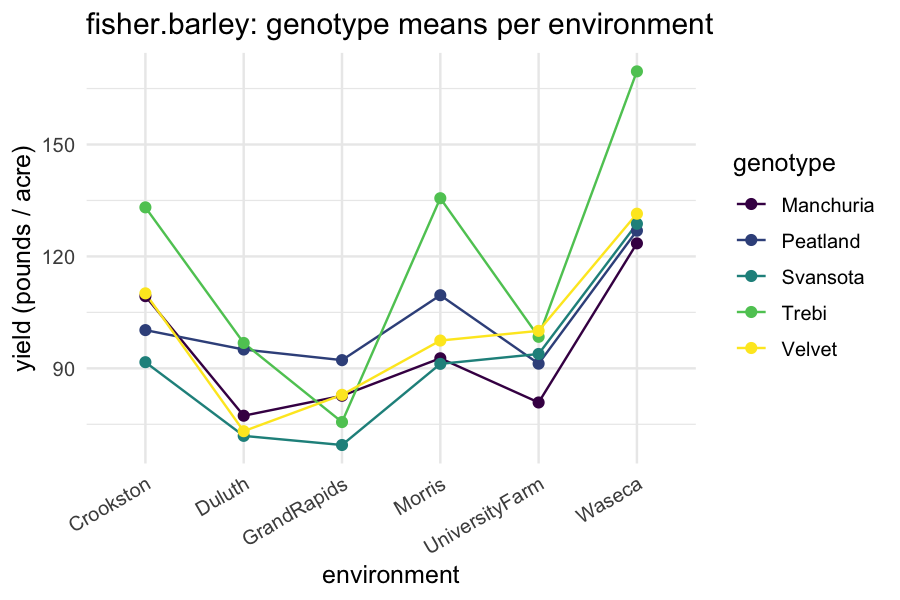
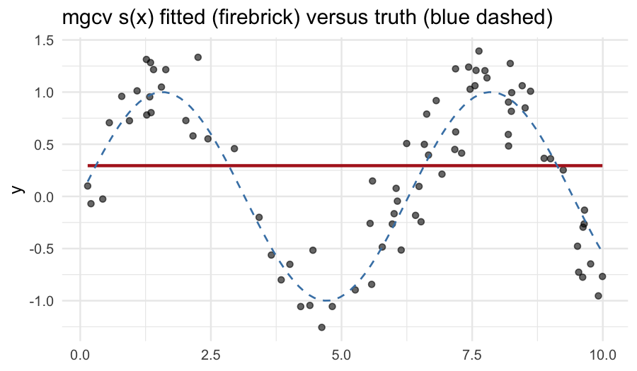
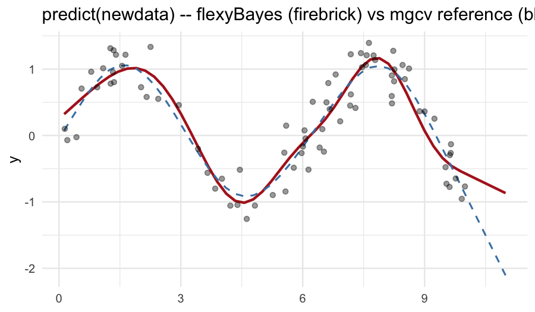

# 1. Why start with regression?

Linear regression is the simplest case `flexyBayes` handles, and
every richer model in the package is a regression model with extra
structure. Starting here makes three things explicit before the
hierarchical, structured-covariance, and spatio-temporal vignettes
build on them.

1. The *fixed-effect* layer of every subsequent model is a regression
   model on its own.
2. Adding a *random effect* (one variance component on top of the
   regression) takes us into the mixed-model regime — illustrated in
   §5 below with `sleepstudy`.
3. Smooth terms (`s()` from `mgcv`) sit naturally inside the
   mixed-model framework; §6 shows the simplest case.

Throughout this tutorial we use the asreml-style API:

* `fixed` — the response and the (fixed) regression formula.
* `random` — random effects (`~ subject`, `~ s(time)`, `~ block`).
* `rcov`  — residual covariance (default `~ units`, i.e. iid).

`fb_brms()` is the Stan (brms) engine pin; with a brms-shaped
formula it covers the random-intercept subset of the term-type
surface, and is introduced in the *getting started* and
*hierarchical models* vignettes.

# 2. One-way analysis of variance: `PlantGrowth`

`datasets::PlantGrowth` records the dried weight of plants under
three treatment conditions: control, treatment 1, treatment 2. The
natural model is a one-way ANOVA — fixed effect for the three-level
factor.


``` r
library(flexyBayes)
data(PlantGrowth)
str(PlantGrowth)
#> 'data.frame':	30 obs. of  2 variables:
#>  $ weight: num  4.17 5.58 5.18 6.11 4.5 4.61 5.17 4.53 5.33 5.14 ...
#>  $ group : Factor w/ 3 levels "ctrl","trt1",..: 1 1 1 1 1 1 1 1 1 1 ...
```


``` r
fit_g <- flexybayes(
  fixed     = weight ~ group, data = PlantGrowth,
  n_samples = 500, warmup = 500, chains = 2, verbose = FALSE
)
summary(fit_g)
#> Bayesian mixed model summary  [flexyBayes / aggregated-gaussian]
#> ================================================================= 
#>   family:     gaussian / identity 
#>   N = 30 , K = 3 
#>   backend:    inla 
#>   exactness:  aggregated_exact 
#>   priors:     custom (explicit prior supplied; see prior_summary()) 
#>   aggregation: N = 30 rows -> K = 3 cells (ratio 10:1)
#> 
#> -- Fixed effects (posterior)  ----------------------------------- 
#>             Estimate Post.SD
#> (Intercept)    5.032  0.1959
#> grouptrt1     -0.371  0.2770
#> grouptrt2      0.494  0.2770
#> 
#> -- Variance components  ---------------------------------------- 
#>   sigma (residual SD): 0.6016
#> 
#>   Run time: 2.32 sec
```

The fixed-effect block reports the baseline (control) mean as the
intercept, and the deviations of `trt1` and `trt2` from baseline.
The residual standard deviation block reports the within-group
spread.

A reference fit with `lm()`:


``` r
summary(lm(weight ~ group, data = PlantGrowth))
#> 
#> Call:
#> lm(formula = weight ~ group, data = PlantGrowth)
#> 
#> Residuals:
#>     Min      1Q  Median      3Q     Max 
#> -1.0710 -0.4180 -0.0060  0.2627  1.3690 
#> 
#> Coefficients:
#>             Estimate Std. Error t value Pr(>|t|)    
#> (Intercept)   5.0320     0.1971  25.527   <2e-16 ***
#> grouptrt1    -0.3710     0.2788  -1.331   0.1944    
#> grouptrt2     0.4940     0.2788   1.772   0.0877 .  
#> ---
#> Signif. codes:  0 '***' 0.001 '**' 0.01 '*' 0.05 '.' 0.1 ' ' 1
#> 
#> Residual standard error: 0.6234 on 27 degrees of freedom
#> Multiple R-squared:  0.2641,	Adjusted R-squared:  0.2096 
#> F-statistic: 4.846 on 2 and 27 DF,  p-value: 0.01591
```

The frequentist least-squares estimates and the Bayesian posterior
means agree to about the second decimal — exactly as expected for a
linear model with weakly informative priors and a moderate sample
size.

# 3. Multiple regression with two factors: `fisher.barley`

`agridat::fisher.barley` (Fisher, 1935) is a small classic: barley
yield in pounds per acre for five varieties grown at six locations
across two years. We model yield as additive in genotype and
environment.


``` r
data(fisher.barley, package = "agridat")
str(fisher.barley)
#> 'data.frame':	60 obs. of  4 variables:
#>  $ yield: num  81 80.7 146.6 100.4 82.3 ...
#>  $ gen  : Factor w/ 5 levels "Manchuria","Peatland",..: 1 1 1 1 1 1 1 1 1 1 ...
#>  $ env  : Factor w/ 6 levels "Crookston","Duluth",..: 5 5 6 6 4 4 1 1 3 3 ...
#>  $ year : int  1931 1932 1931 1932 1931 1932 1931 1932 1931 1932 ...
```


``` r
fit_barley <- flexybayes(
  fixed     = yield ~ gen + env, data = fisher.barley,
  n_samples = 500, warmup = 500, chains = 2, verbose = FALSE
)
summary(fit_barley)
#> Bayesian mixed model summary  [flexyBayes / aggregated-gaussian]
#> ================================================================= 
#>   family:     gaussian / identity 
#>   N = 60 , K = 30 
#>   backend:    inla 
#>   exactness:  aggregated_exact 
#>   priors:     custom (explicit prior supplied; see prior_summary()) 
#>   aggregation: N = 60 rows -> K = 30 cells (ratio 2:1)
#> 
#> -- Fixed effects (posterior)  ----------------------------------- 
#>                   Estimate Post.SD
#> (Intercept)       101.6939  7.1481
#> genPeatland         7.0738  7.3537
#> genSvansota        -4.0042  7.3523
#> genTrebi           22.2787  7.3564
#> genVelvet           3.8127  7.3532
#> envDuluth         -23.8349  7.9345
#> envGrandRapids    -26.0362  7.9352
#> envMorris          -2.1411  7.9287
#> envUniversityFarm -14.1321  7.9316
#> envWaseca          27.5275  7.9255
#> 
#> -- Variance components  ---------------------------------------- 
#>   sigma (residual SD): 18.6454
#> 
#>   Run time: 2.38 sec
```

The two factor blocks are reported relative to the (alphabetically
first) baseline level of each. To get *marginal means* per genotype
and per environment, use `emmeans` — see Tutorial 08 (downstream
analysis).

A standard exploratory plot of the cell means:


``` r
library(ggplot2)
ggplot(fisher.barley,
       aes(x = env, y = yield, group = gen, colour = gen)) +
  geom_line(stat = "summary", fun = mean) +
  geom_point(stat = "summary", fun = mean, size = 2) +
  scale_colour_viridis_d() +
  theme_minimal(base_size = 12) +
  theme(axis.text.x = element_text(angle = 30, hjust = 1)) +
  labs(x = "environment", y = "yield (pounds / acre)",
       colour = "genotype",
       title = "fisher.barley: genotype means per environment")
```



# 4. Continuous predictors: pooled `sleepstudy`

`lme4::sleepstudy` records reaction time under sleep restriction
across 18 subjects and 10 days. Ignoring the subject grouping for
now — a *pooled* regression of reaction on days:


``` r
data(sleepstudy, package = "lme4")
fit_pool <- flexybayes(
  fixed     = Reaction ~ Days, data = sleepstudy,
  n_samples = 500, warmup = 500, chains = 2, verbose = FALSE
)
summary(fit_pool)
#> Bayesian fit summary  [flexybayes_inla / INLA backend]
#> ------------------------------------------------------------ 
#> Fixed effects:
#>                 mean     sd 0.025quant 0.5quant 0.975quant     mode kld
#> (Intercept) 251.4782 6.6538   238.4168 251.4778   264.5420 251.4778   0
#> Days         10.4510 1.2461     8.0045  10.4511    12.8971  10.4511   0
#> 
#> Hyperparameters:
#>                                          mean sd 0.025quant 0.5quant 0.975quant
#> Precision for the Gaussian observations 4e-04  0      4e-04    4e-04      5e-04
#>                                          mode
#> Precision for the Gaussian observations 4e-04
#> 
#> Random effects:
#>   (none)
#> ------------------------------------------------------------
```

The slope on `Days` is the average per-day increase in reaction
time. The residual standard deviation absorbs *both* within-subject
and between-subject variation, which is wasteful — different
subjects have different baseline reaction times, and a pooled
regression spends one big residual on what is structurally two
separate sources of variation.

# 5. Adding a random intercept on `Subject`

The minimal upgrade from §4: keep the same fixed slope on `Days` but
let each subject have its own baseline reaction time. In ASReml
syntax, this is one extra random term:


``` r
fit_re <- flexybayes(
  fixed     = Reaction ~ Days, data = sleepstudy,
  random    = ~ Subject,
  n_samples = 500, warmup = 500, chains = 2, verbose = FALSE
)
summary(fit_re)
#> Bayesian fit summary  [flexybayes_inla / INLA backend]
#> ------------------------------------------------------------ 
#> Fixed effects:
#>                 mean      sd 0.025quant 0.5quant 0.975quant     mode kld
#> (Intercept) 251.4357 10.9164   229.9965 251.4356   272.8750 251.4356   0
#> Days         10.4605  0.8055     8.8792  10.4605    12.0416  10.4605   0
#> 
#> Hyperparameters:
#>                                           mean     sd 0.025quant 0.5quant
#> Precision for the Gaussian observations 0.0010 0.0001      8e-04   0.0010
#> Precision for Subject                   0.0019 0.0019      6e-04   0.0012
#>                                         0.975quant  mode
#> Precision for the Gaussian observations     0.0013 1e-03
#> Precision for Subject                       0.0070 7e-04
#> 
#> Random effects:
#>   groups: Subject
#> ------------------------------------------------------------
```

Two things change relative to the pooled fit in §4.

* A second variance component appears: the standard deviation of the
  `Subject`-level random intercepts. Under the v0.1 default this is
  given a bounded uniform prior — `sd(Subject) ~ uniform(0, 5*sd(y))`
  — a weakly-informative choice for this moderate group count (for
  very small `J`, Gelman (2006) recommends a half-Cauchy instead).
* The residual standard deviation drops, because between-subject
  variance is no longer absorbed into it.

The `Reaction ~ Days + (1 | Subject)` formulation in `lme4` /
`brms` is a notational shortcut for exactly this model. Tutorial 04
(hierarchical models) extends this by adding random *slopes* on
`Days` per subject; structurally that is just one more random term.

This is the smallest mixed-model regression, and the structural
template every subsequent vignette builds on.

# 6. Smooth terms via `mgcv::s()`

A penalised spline lets us add a smooth, non-linear effect of a
continuous predictor without committing to a specific functional
form. In `mgcv` the smooth specifier is `s(...)`; `flexyBayes`
ingests it directly via `mgcv::smoothCon()`. Under the hood the
basis is a random effect with a smoothness-penalising covariance,
so `s(x)` lives in the `random` argument.

We illustrate with a synthetic sinusoid plus noise — a clean test
of how well a flexible smoother recovers the underlying signal.


``` r
n  <- 80
x  <- sort(runif(n, 0, 10))
y  <- sin(x) + rnorm(n, 0, 0.3)
sim_dat <- data.frame(y = y, x = x)
```


``` r
fit_smooth <- flexybayes(
  fixed     = y ~ 1,
  random    = ~ s(x),
  data      = sim_dat,
  n_samples = 500, warmup = 500, chains = 2, verbose = FALSE
)
summary(fit_smooth)
#> Bayesian mixed model summary  [flexyBayes]
#> ============================================================ 
#>   Fixed  : y ~ 1 
#>   Random : ~s(x) 
#>   Family : gaussian / identity 
#>   N = 80 , chains = 2 , samples = 500 
#>   Representation: exact
#>   Engine:         greta MCMC
#> 
#> -- Fixed effects (posterior)  --------------------------------- 
#>             Estimate Post.SD   2.5%  97.5%
#> (Intercept)   0.2948  0.0363 0.2219 0.3639
#> 
#> -- Variance components  -------------------------------------- 
#>     Component Estimate     SD   2.5%  97.5%
#> 1   sigma_s_x   1.7848 0.4769 1.0524 2.8698
#> 2 sigma_e_atg   0.3139 0.0281 0.2627 0.3716
#> 
#> -- Convergence  --------------------------------------------- 
#>   Rhat range: 1 - 2.482 
#>   ESS  range: 17 - 203 
#>   Run time  : 5.1 sec
```

The fixed block has only an intercept; the random block names the
mgcv smooth. The residual sigma block reports the noise standard
deviation; in our simulation we set it to 0.3 and the posterior
should bracket this value.

A fitted-curve overlay:


``` r
sim_dat$fitted <- as.numeric(fitted(fit_smooth))
sim_dat <- sim_dat[order(sim_dat$x), ]
ggplot(sim_dat, aes(x = x, y = y)) +
  geom_point(alpha = 0.6) +
  geom_line(aes(y = fitted), colour = "firebrick", linewidth = 1) +
  geom_function(fun = sin, colour = "steelblue", linewidth = 0.6,
                linetype = "dashed") +
  theme_minimal(base_size = 12) +
  labs(title = "mgcv s(x) fitted (firebrick) versus truth (blue dashed)",
       x = NULL, y = "y")
```



The fitted curve traces the underlying sinusoid; the residual is
unstructured noise. Choosing the basis dimension `k` is a trade-off
— too few and the curve cannot bend enough; too many and the
penalty must do more work to avoid overfitting. The default `k = 10`
is a sensible starting point; pass `s(x, k = 15)` to widen.

## 6.1 Predicting on new `x` values

`predict(fit, newdata = ...)` on a smooth fit re-evaluates the
spline basis on the new `x` positions via `mgcv::PredictMat()` on
the retained basis object. The basis-coefficient vector comes from
the posterior-mean of `s_x_raw * sigma_s_x`. The next chunk
overlays the `flexyBayes` prediction against the `mgcv::predict.gam()`
reference on a fresh grid that includes a 10% extrapolation margin
beyond the training range.


``` r
greta_mgcv_ggplot_ok <- isTRUE(greta_ok) && isTRUE(mgcv_ok) &&
                        isTRUE(ggplot2_ok)
```


``` r
if (greta_mgcv_ggplot_ok) {
newx <- data.frame(
  x = seq(min(sim_dat$x) * 0.9, max(sim_dat$x) * 1.1,
          length.out = 50L)
)
newx$flexyBayes <- predict(fit_smooth, newdata = newx)
ref <- mgcv::gam(y ~ s(x), data = sim_dat)
newx$mgcv <- as.numeric(predict(ref, newdata = newx))
ggplot(newx, aes(x = x)) +
  geom_line(aes(y = flexyBayes), colour = "firebrick",
            linewidth = 1) +
  geom_line(aes(y = mgcv), colour = "steelblue", linetype = "dashed",
            linewidth = 0.7) +
  geom_point(data = sim_dat, aes(x = x, y = y), alpha = 0.4,
             inherit.aes = FALSE) +
  theme_minimal(base_size = 12) +
  labs(title = "predict(newdata) -- flexyBayes (firebrick) vs mgcv reference (blue dashed)",
       x = NULL, y = "y")
}
```



The two curves agree on the training range and bend together on the
extrapolation margin. Before this fix the `flexyBayes` curve was
silently wrong outside the training range — `stats::model.matrix()`
cannot re-evaluate the spline basis on new `x` values, so the
prediction inadvertently used the *training* basis tied to the
training-data quantile structure.

The legacy ASReml-style spline term `spl(x, type = "ps", df = m)`
remains supported for backward compatibility with prior code; `s()`
is the recommended path going forward. Tensor-product smooths
`te()`, `ti()`, and `t2()` are queued for a future release.

# 7. Pitfalls

**The intercept absorbs the reference level.** Factor coefficients
are reported as deviations from the alphabetical-first level. Set
`contrasts(...)` explicitly if you need a different baseline.

**`s()` and `spl()` are *random* terms.** A common mistake is to
write `fixed = y ~ x + s(x)`. That fails — smooths belong in the
`random` formula. The recommended pattern is
`fixed = y ~ 1, random = ~ s(x)` for a smooth-only model, or
`fixed = y ~ z, random = ~ s(x)` for a partially linear model.

**`predict()` on factor newdata.** When predicting at unseen factor
levels, R will throw an error or produce an `NA`. Pre-process
`newdata` to set factor levels explicitly.

**Smooth prediction at new x's.** As of v0.2.5,
`predict.flexybayes(fit, newdata = ...)` correctly re-evaluates the
spline basis on the new `x` positions via `mgcv::PredictMat()` on
the retained basis object. See section 6.1 above for the overlay
against the `mgcv::predict.gam()` reference. Legacy fits saved
before v0.2.5 cannot use the new path and receive a structured
refusal — re-fit on the current package version to enable
`predict(newdata)`.

# 8. Active prompts

1. Refit `PlantGrowth` with the contrast set to `contr.sum`. How do
   the fixed-effect coefficients change? How does the intercept
   change?
2. Vary `k` in `s(x, k = ...)` from 5 to 30 on the synthetic
   sinusoid. At what `k` does the penalty start to bite?
3. Add a random effect on a subject identifier in your own data and
   compare the residual sigma to the pooled-regression residual
   sigma. By how much does the residual shrink?

# 9. Session information


``` r
sessionInfo()
#> R version 4.5.2 (2025-10-31)
#> Platform: aarch64-apple-darwin20
#> Running under: macOS Tahoe 26.5.1
#> 
#> Matrix products: default
#> BLAS:   /System/Library/Frameworks/Accelerate.framework/Versions/A/Frameworks/vecLib.framework/Versions/A/libBLAS.dylib 
#> LAPACK: /Library/Frameworks/R.framework/Versions/4.5-arm64/Resources/lib/libRlapack.dylib;  LAPACK version 3.12.1
#> 
#> locale:
#> [1] en_AU.UTF-8/en_AU.UTF-8/en_AU.UTF-8/C/en_AU.UTF-8/en_AU.UTF-8
#> 
#> time zone: Australia/Adelaide
#> tzcode source: internal
#> 
#> attached base packages:
#> [1] stats     graphics  grDevices utils     datasets  methods   base     
#> 
#> other attached packages:
#> [1] ggplot2_4.0.3    flexyBayes_0.7.0
#> 
#> loaded via a namespace (and not attached):
#>   [1] DBI_1.3.0              mnormt_2.1.2           tfautograph_0.3.2     
#>   [4] sandwich_3.1-1         rlang_1.2.0            magrittr_2.0.5        
#>   [7] multcomp_1.4-29        otel_0.2.0             matrixStats_1.5.0     
#>  [10] e1071_1.7-17           compiler_4.5.2         mgcv_1.9-3            
#>  [13] loo_2.9.0              png_0.1-9              callr_3.7.6           
#>  [16] vctrs_0.7.3            reshape2_1.4.5         stringr_1.6.0         
#>  [19] pkgconfig_2.0.3        crayon_1.5.3           backports_1.5.1       
#>  [22] labeling_0.4.3         MatrixModels_0.5-4     torch_0.17.0          
#>  [25] bit_4.6.0              INLA_25.10.19          xfun_0.57             
#>  [28] jsonlite_2.0.0         progress_1.2.3         parallel_4.5.2        
#>  [31] prettyunits_1.2.0      tensorflow_2.20.0      R6_2.6.1              
#>  [34] stringi_1.8.7          RColorBrewer_1.1-3     reticulate_1.45.0     
#>  [37] parallelly_1.47.0      numDeriv_2016.8-1.1    estimability_1.5.1    
#>  [40] Rcpp_1.1.1-1.1         knitr_1.51             zoo_1.8-15            
#>  [43] base64enc_0.1-6        bayesplot_1.15.0       Matrix_1.7-4          
#>  [46] splines_4.5.2          tidyselect_1.2.1       dichromat_2.0-0.1     
#>  [49] abind_1.4-8            agridat_1.26           codetools_0.2-20      
#>  [52] processx_3.9.0         listenv_0.10.1         gretaR_0.2.0          
#>  [55] lattice_0.22-7         tibble_3.3.1           plyr_1.8.9            
#>  [58] withr_3.0.2            bridgesampling_1.2-1   S7_0.2.2              
#>  [61] posterior_1.7.0        coda_0.19-4.1          evaluate_1.0.5        
#>  [64] marginaleffects_0.32.0 future_1.70.0          survival_3.8-3        
#>  [67] sf_1.1-0               units_1.0-1            proxy_0.4-29          
#>  [70] RcppParallel_5.1.11-2  pillar_1.11.1          tensorA_0.36.2.1      
#>  [73] whisker_0.4.1          KernSmooth_2.23-26     checkmate_2.3.4       
#>  [76] stats4_4.5.2           sn_2.1.3               distributional_0.7.0  
#>  [79] generics_0.1.4         hms_1.1.4              rstantools_2.6.0      
#>  [82] scales_1.4.0           coro_1.1.0             globals_0.19.1        
#>  [85] xtable_1.8-8           class_7.3-23           glue_1.8.1            
#>  [88] emmeans_2.0.2          tools_4.5.2            data.table_1.18.2.1   
#>  [91] mvtnorm_1.3-6          grid_4.5.2             nlme_3.1-168          
#>  [94] cli_3.6.6              tfruns_1.5.4           viridisLite_0.4.3     
#>  [97] fmesher_0.7.0          Brobdingnag_1.2-9      dplyr_1.2.1           
#> [100] gtable_0.3.6           greta_0.5.1            digest_0.6.39         
#> [103] classInt_0.4-11        TH.data_1.1-5          brms_2.23.0           
#> [106] farver_2.1.2           lifecycle_1.0.5        bit64_4.8.0           
#> [109] MASS_7.3-65
```

# References

Eilers, P. H. C., & Marx, B. D. (1996). Flexible smoothing with
B-splines and penalties. *Statistical Science*, 11(2), 89–121.

Fisher, R. A. (1935). *The design of experiments*. Edinburgh:
Oliver & Boyd.

Gelman, A. (2006). Prior distributions for variance parameters in
hierarchical models. *Bayesian Analysis*, 1(3), 515–534.

Wood, S. N. (2017). *Generalized additive models: An introduction
with R* (2nd ed.). Chapman & Hall / CRC.
