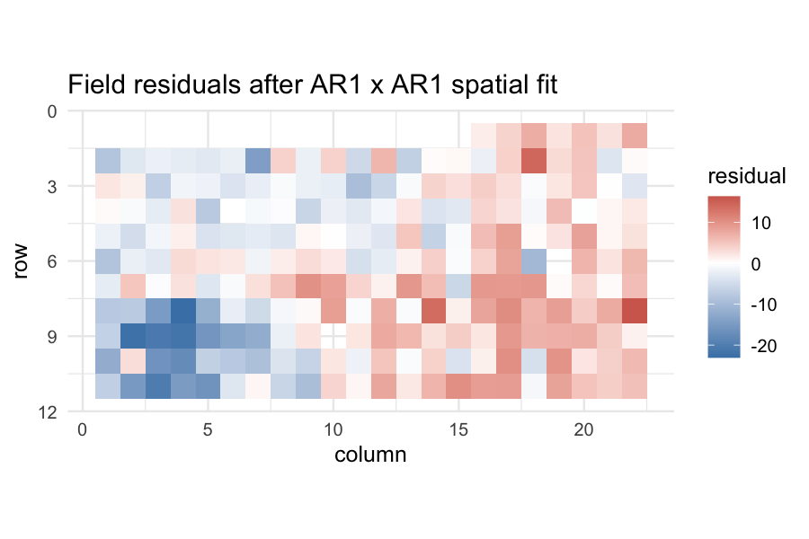

# 1. Why spatio-temporal models?

Two classes of correlation are nearly universal in applied data and
nearly always ignored:

- **Spatial correlation.** Field trials, geostatistical surveys,
  remote-sensing measurements: nearby observations are more similar
  than distant ones, even after accounting for treatment effects.
- **Temporal correlation.** Repeated measurements on the same
  experimental unit: today's reading carries information about
  tomorrow's, even after accounting for time trend.

Ignoring either kind of correlation has the same effect: standard
errors are biased downward, posterior credible intervals are too
narrow, and inferences look more confident than the data warrant.

`flexyBayes` v0.1 covers two correlation structures:

- **first-order autoregressive** (`ar1`) on a regular ordered factor
  — for time, columns, or rows;
- **separable two-dimensional autoregressive** (`ar1(row):ar1(col)`)
  on a regular field grid — the workhorse of agricultural field-
  trial analysis (Gilmour, Cullis, & Verbyla, 1997).

INLA's spatial machinery — Besag-York-Mollié 2 (BYM2) for areal
data, the stochastic partial differential equation (SPDE) approach
for irregular geography, and the Hilbert-space approximate Gaussian
process (HSGP) for fast continuous-domain approximations —
substantially more powerful for irregular geographies — is on the
roadmap.

# 2. The spatial AR1×AR1 model: `stroup.nin`

`agridat::stroup.nin` is the canonical Nebraska wheat trial (Stroup,
2002): 56 genotypes laid out in a 22-row × 11-column field with
some missing yields, replicated three times. The classic
mixed-model analysis is:

$$
y_{ijk} = \mu + \tau_i + g_j + e_{ijk},
$$

with $\tau_i$ replicate effects, $g_j \sim \mathcal{N}(0,
\sigma_g^2)$ random genotype effects, and $\{e_{ijk}\}$ residuals
that are *correlated in space* — separable autoregressive on row and
column.


``` r
library(flexyBayes)
data(stroup.nin, package = "agridat")
sn <- stroup.nin[!is.na(stroup.nin$yield) & !is.na(stroup.nin$rep), ]
sn$row <- factor(sn$row)
sn$col <- factor(sn$col)
str(sn)
#> 'data.frame':	224 obs. of  5 variables:
#>  $ gen  : Factor w/ 56 levels "Arapahoe","Brule",..: 12 2 50 7 1 14 15 16 4 52 ...
#>  $ rep  : Factor w/ 4 levels "R1","R2","R3",..: 1 1 1 1 1 1 1 1 1 1 ...
#>  $ yield: num  29.2 31.6 35 30.1 33 ...
#>  $ col  : Factor w/ 22 levels "1","2","3","4",..: 16 17 18 19 20 21 22 1 2 3 ...
#>  $ row  : Factor w/ 11 levels "1","2","3","4",..: 1 1 1 1 1 1 1 2 2 2 ...
```


``` r
fit_spatial <- flexybayes(
  fixed     = yield ~ 1 + rep,
  random    = ~ gen,
  rcov      = ~ ar1(row):ar1(col),
  data      = sn,
  n_samples = mcmc_small$n_samples,
  warmup    = mcmc_small$warmup,
  chains    = mcmc_small$chains,
  verbose   = FALSE
)
fit_spatial
#> Bayesian mixed model  [flexyBayes]
#> ------------------------------------------------------- 
#>   Fixed  : yield ~ 1 + rep 
#>   Random : ~gen 
#>   Rcov   : ~ar1(row):ar1(col) 
#>   Family : gaussian ( identity link )
#>   MCMC   : 1 chain(s) x 200 samples (warmup = 200 ) -- 2.1 sec
#>   Params : 4 monitored; 2 fixed, 1 random terms
#>   Min ESS: 1 
#> ------------------------------------------------------- 
#>   $glm    -- GLM-compatible (summary, emmeans, etc.)
#>   $greta  -- native greta (draws, model, calculate)
#>   $extras -- diagnostics, BLUPs, variance components
```

The variance-component block reports the genotype variance and the
two AR1 correlation parameters — one for rows, one for columns — plus
the residual standard deviation. AR1 correlations near 1 indicate
strong spatial autocorrelation; values near 0 indicate the
independence model is approximately correct.

A common diagnostic is the *plot* of the field-trial residuals: if
spatial correlation has been adequately accounted for, the
residuals are visually unstructured.


``` r
sn$resid <- residuals(fit_spatial, type = "response")
library(ggplot2)
ggplot(sn, aes(x = as.numeric(col), y = as.numeric(row), fill = resid)) +
  geom_tile() +
  scale_fill_gradient2(low = "steelblue", mid = "white", high = "firebrick",
                       midpoint = 0) +
  scale_y_reverse() +
  coord_fixed() +
  theme_minimal(base_size = 12) +
  labs(x = "column", y = "row", fill = "residual",
       title = "Field residuals after AR1 x AR1 spatial fit")
```



A patchy field — large red and blue regions — indicates remaining
spatial structure that the AR1×AR1 has not captured. The natural
extensions are an additional global spatial trend (e.g., `pol(row,
2) + pol(col, 2)` in `random`) or a more flexible spatial covariance.

# 3. Temporal correlation: longitudinal recast of `sleepstudy`

The `sleepstudy` data are inherently longitudinal — ten consecutive
days of measurement on each subject. The hierarchical-models
vignette analysed it with a random subject intercept; here we add an
AR1 correlation on the residuals to acknowledge that within-subject
errors on adjacent days are likely correlated.


``` r
data(sleepstudy, package = "lme4")
sleepstudy$Days_f <- factor(sleepstudy$Days, levels = 0:9)
str(sleepstudy)
#> 'data.frame':	180 obs. of  4 variables:
#>  $ Reaction: num  250 259 251 321 357 ...
#>  $ Days    : num  0 1 2 3 4 5 6 7 8 9 ...
#>  $ Subject : Factor w/ 18 levels "308","309","310",..: 1 1 1 1 1 1 1 1 1 1 ...
#>  $ Days_f  : Factor w/ 10 levels "0","1","2","3",..: 1 2 3 4 5 6 7 8 9 10 ...
```


``` r
fit_temporal <- flexybayes(
  fixed     = Reaction ~ Days,
  random    = ~ Subject,
  rcov      = ~ ar1(Days_f):Subject,
  data      = sleepstudy,
  n_samples = mcmc_small$n_samples,
  warmup    = mcmc_small$warmup,
  chains    = mcmc_small$chains,
  verbose   = FALSE
)
fit_temporal
#> Bayesian mixed model  [flexyBayes]
#> ------------------------------------------------------- 
#>   Fixed  : Reaction ~ Days 
#>   Random : ~Subject 
#>   Rcov   : ~ar1(Days_f):Subject 
#>   Family : gaussian ( identity link )
#>   MCMC   : 1 chain(s) x 200 samples (warmup = 200 ) -- 2 sec
#>   Params : 4 monitored; 2 fixed, 1 random terms
#>   Min ESS: 1 
#> ------------------------------------------------------- 
#>   $glm    -- GLM-compatible (summary, emmeans, etc.)
#>   $greta  -- native greta (draws, model, calculate)
#>   $extras -- diagnostics, BLUPs, variance components
```

The new variance component is the AR1 correlation parameter: the
correlation between residuals one day apart. A correlation near
zero means the random-intercept model has already absorbed most of
the within-subject dependence; a correlation near one means the
dependence is strong and the random-intercept fit was understating
uncertainty.

# 4. Spatial trend in addition to AR1

Field trials often display *both* small-scale spatial correlation
(captured by AR1×AR1) and *large-scale* spatial trend (a slowly
varying gradient across the field). The two are layered:

```r
flexybayes(
  fixed = yield ~ rep,
  random = ~ gen + spl(row) + spl(col),         # global smooth trend
  rcov   = ~ ar1(row):ar1(col),                  # local spatial AR1
  data = ...
)
```

The penalised splines on row and column capture global gradient; the
AR1×AR1 captures local short-range correlation. This composite is
the agronomy-textbook decomposition (Gilmour, Cullis, & Verbyla,
1997).

# 5. Limitations of the current spatial coverage

`flexyBayes` v0.2 covers regular grids with AR1 correlation. It does
*not* cover:

- **irregular geography** — the SPDE / Matérn approach (Lindgren,
  Rue, & Lindström, 2011) is on the roadmap;
- **areal data** — the BYM2 model (Riebler, Sørbye, Simpson, & Rue,
  2016) is on the roadmap;
- **continuous-time temporal correlation** — the
  Ornstein–Uhlenbeck and continuous-AR processes are on the v0.3
  roadmap;
- **spatio-temporal interaction** — separable space-time covariance
  is on the roadmap.

For these models in the current release, route directly through
`R-INLA` or `mgcv::gam(s = bs = "re")` with the relevant spatial
basis. The *backend internals* vignette describes how a third-party
fit can plug into `triangulate()` via the `fb_as_draws_simple`
interface.

# 6. Pitfalls

**Row and column must be factors.** `flexyBayes` reads `ar1(row)` as
"AR1 correlation on the levels of `row` in their factor order".
Numeric `row` is coerced; if your row labels are not in field-order
when factor-coerced, the AR1 correlation will be wrong. Set the
factor levels explicitly: `factor(row, levels = sort(unique(row)))`.

**The residual AR1 is not a substitute for design.** A poorly-
designed trial cannot be rescued by spatial-error modelling. A
randomised block design is still essential; the AR1 captures *what
remains* after design accounts for the planned variation.

**Identifiability with too few rows or columns.** A 4-row × 3-column
field with 12 plots cannot identify both an AR1 correlation and a
random-effect variance component — the data have insufficient degrees
of freedom. Convergence diagnostics will flag this; refit without
the AR1 and accept the simpler model.

**INLA refuses AR1×AR1 in v0.1.** The `lgm_gate()` filter refuses
spatial-AR1 dispatch to INLA via the structured-covariance route in
v0.1; the greta backend handles it natively. v0.2 adds INLA-side
support for separable AR1 via `f(row, model = "ar1")` plus group
indices.

# 7. Active prompts

1. Refit `stroup.nin` with `rcov = ~ units` (no spatial structure).
   How much does the genotype-level posterior change? How much
   does $\sigma_e$ change?
2. Add a spatial trend to the AR1×AR1 fit:
   `random = ~ gen + spl(as.numeric(row)) + spl(as.numeric(col))`.
   What happens to the AR1 correlation parameters?
3. Refit `sleepstudy` with both random-subject-slope (asreml form:
   `~ Subject + Subject:Days`) and the AR1 on residuals.
   Which partition of variance dominates?

# 8. Session information


``` r
sessionInfo()
#> R version 4.5.2 (2025-10-31)
#> Platform: aarch64-apple-darwin20
#> Running under: macOS Tahoe 26.4.1
#> 
#> Matrix products: default
#> BLAS:   /System/Library/Frameworks/Accelerate.framework/Versions/A/Frameworks/vecLib.framework/Versions/A/libBLAS.dylib 
#> LAPACK: /Library/Frameworks/R.framework/Versions/4.5-arm64/Resources/lib/libRlapack.dylib;  LAPACK version 3.12.1
#> 
#> locale:
#> [1] C.UTF-8/C.UTF-8/C.UTF-8/C/C.UTF-8/C.UTF-8
#> 
#> time zone: Australia/Adelaide
#> tzcode source: internal
#> 
#> attached base packages:
#> [1] stats     graphics  grDevices utils     datasets  methods   base     
#> 
#> other attached packages:
#> [1] bayesplot_1.15.0      emmeans_2.0.2         ggplot2_4.0.3        
#> [4] flexyBayes_0.2.0.9000
#> 
#> loaded via a namespace (and not attached):
#>   [1] Rdpack_2.6.6           DBI_1.3.0              mnormt_2.1.2          
#>   [4] tfautograph_0.3.2      sandwich_3.1-1         rlang_1.2.0           
#>   [7] magrittr_2.0.5         multcomp_1.4-29        otel_0.2.0            
#>  [10] ggridges_0.5.7         matrixStats_1.5.0      e1071_1.7-17          
#>  [13] compiler_4.5.2         mgcv_1.9-3             loo_2.9.0             
#>  [16] png_0.1-9              callr_3.7.6            vctrs_0.7.3           
#>  [19] reshape2_1.4.5         stringr_1.6.0          pkgconfig_2.0.3       
#>  [22] crayon_1.5.3           backports_1.5.1        labeling_0.4.3        
#>  [25] effectsize_1.0.2       nloptr_2.2.1           MatrixModels_0.5-4    
#>  [28] INLA_25.10.19          xfun_0.57              jsonlite_2.0.0        
#>  [31] progress_1.2.3         parallel_4.5.2         prettyunits_1.2.0     
#>  [34] tensorflow_2.20.0      R6_2.6.1               stringi_1.8.7         
#>  [37] RColorBrewer_1.1-3     reticulate_1.45.0      parallelly_1.47.0     
#>  [40] boot_1.3-32            numDeriv_2016.8-1.1    estimability_1.5.1    
#>  [43] Rcpp_1.1.1-1.1         knitr_1.51             zoo_1.8-15            
#>  [46] parameters_0.28.3      base64enc_0.1-6        Matrix_1.7-4          
#>  [49] splines_4.5.2          tidyselect_1.2.1       dichromat_2.0-0.1     
#>  [52] abind_1.4-8            agridat_1.26           codetools_0.2-20      
#>  [55] processx_3.9.0         listenv_0.10.1         lattice_0.22-7        
#>  [58] tibble_3.3.1           plyr_1.8.9             bayestestR_0.17.0     
#>  [61] withr_3.0.2            S7_0.2.2               posterior_1.7.0       
#>  [64] coda_0.19-4.1          evaluate_1.0.5         marginaleffects_0.32.0
#>  [67] future_1.70.0          survival_3.8-3         sf_1.1-0              
#>  [70] units_1.0-1            proxy_0.4-29           pillar_1.11.1         
#>  [73] tensorA_0.36.2.1       whisker_0.4.1          KernSmooth_2.23-26    
#>  [76] checkmate_2.3.4        stats4_4.5.2           insight_1.4.6         
#>  [79] reformulas_0.4.4       sn_2.1.3               distributional_0.7.0  
#>  [82] generics_0.1.4         hms_1.1.4              scales_1.4.0          
#>  [85] minqa_1.2.8            globals_0.19.1         xtable_1.8-8          
#>  [88] class_7.3-23           glue_1.8.1             tools_4.5.2           
#>  [91] data.table_1.18.2.1    lme4_2.0-1             mvtnorm_1.3-6         
#>  [94] grid_4.5.2             rbibutils_2.4.1        datawizard_1.3.0      
#>  [97] nlme_3.1-168           cli_3.6.6              tfruns_1.5.4          
#> [100] viridisLite_0.4.3      fmesher_0.7.0          dplyr_1.2.1           
#> [103] gtable_0.3.6           greta_0.5.1            digest_0.6.39         
#> [106] classInt_0.4-11        TH.data_1.1-5          farver_2.1.2          
#> [109] lifecycle_1.0.5        MASS_7.3-65
```

# References

Cullis, B. R., Smith, A. B., & Coombes, N. E. (2006). On the design
of early generation variety trials with correlated data. *Journal of
Agricultural, Biological, and Environmental Statistics*, 11(4),
381–393.

Gilmour, A. R., Cullis, B. R., & Verbyla, A. P. (1997). Accounting
for natural and extraneous variation in the analysis of field
experiments. *Journal of Agricultural, Biological, and Environmental
Statistics*, 2(3), 269–293.

Lindgren, F., Rue, H., & Lindström, J. (2011). An explicit link
between Gaussian fields and Gaussian Markov random fields: The
stochastic partial differential equation approach. *Journal of the
Royal Statistical Society: Series B*, 73(4), 423–498.

Riebler, A., Sørbye, S. H., Simpson, D., & Rue, H. (2016). An
intuitive Bayesian spatial model for disease mapping that accounts
for scaling. *Statistical Methods in Medical Research*, 25(4),
1145–1165.

Stroup, W. W. (2002). Power analysis based on spatial effects mixed
models: A tool for comparing design and analysis strategies in the
presence of spatial variability. *Journal of Agricultural,
Biological, and Environmental Statistics*, 7(4), 491–511.
