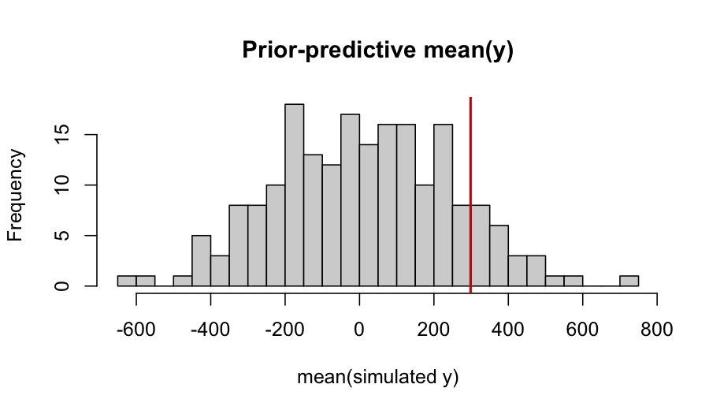

# 1. Why priors matter

In the Bayesian view, every parameter must have a prior. *Default*
priors — the ones a software package chooses for you — are loaded
with implicit assumptions, and those assumptions can dominate
inference when the data are weakly informative. Two situations in
which a default does most of the work:

- **Small group counts.** A random-effect standard deviation
  estimated from ten clusters borrows heavily from the prior. A
  long-tailed prior on $\sigma$ then propagates a long-tailed
  posterior on the BLUPs (best linear unbiased predictors), even
  when the data themselves contain almost no signal about variance.
- **Boundary problems.** When the variance is near zero, the
  posterior on $\sigma$ has most of its mass close to the boundary.
  A prior that puts its mode at zero reflects this honestly; a prior
  with a mode away from zero (lognormal, gamma) introduces an
  artefactual bump.

`flexyBayes` ships a *penalised-complexity* (PC) prior as the default
on every variance component (Simpson, Rue, Riebler, Martins, &
Sørbye, 2017) and exposes a domain-specific language (DSL),
`fb_prior()`, that translates a single prior specification into the
parameterisation each backend (greta, INLA, brms passthrough)
expects. This vignette explains the choice, the DSL, and how to use
it deliberately.

# 2. Penalised-complexity priors

Simpson et al. (2017) propose *penalised complexity* as a principled
default for model-component priors. The argument has four steps.

1. **A baseline.** Identify a "simpler" version of the model
   component — for a random effect, the simpler model is the *no
   random effect* limit ($\sigma = 0$). For a covariance, it is the
   *uncorrelated* limit. For a smoother, it is the *constant* limit.
2. **A distance to the baseline.** Use the
   Kullback–Leibler divergence $\mathrm{KL}(M \,\|\, M_0)$ from
   the model $M$ at parameter $\sigma$ to the baseline $M_0$. Define
   $d(\sigma) = \sqrt{2\,\mathrm{KL}(M(\sigma) \,\|\, M_0)}$. For
   many model components, $d(\sigma)$ is monotone in $\sigma$.
3. **A constant-rate penalty.** Place an exponential prior on
   $d(\sigma)$ — exponential because it is the unique distribution
   with a constant *rate of contraction* toward the baseline. Under
   the change-of-variables, this becomes an explicit prior on
   $\sigma$.
4. **A user-readable scaling.** Calibrate the rate via a single
   tail-probability statement:
   $\Pr(\sigma > U) = \alpha$, for a user-chosen *upper* and a small
   *probability*.

For a Gaussian random-effect standard deviation, the resulting prior
is

$$
\sigma \sim \text{Exponential}\!\left(\lambda\right),
\qquad
\lambda = \frac{-\log \alpha}{U}.
$$

The mode is at zero and the density decays exponentially with rate
$\lambda$. The choice of $(U, \alpha)$ encodes a single
domain-readable statement: *"I think the random-effect standard
deviation exceeds $U$ with probability about $\alpha$."*

For example, on the response scale of `sleepstudy::Reaction` (where
$\mathrm{sd}(y) \approx 56$), choosing $U = 56$ and $\alpha = 0.05$
states that the subject-level SD is unlikely to exceed one
response-SD, with five percent prior probability for "exceeds". The
PC prior is then $\sigma \sim \text{Exponential}(0.0535)$.

The PC prior:

- has mode at the simpler model ($\sigma = 0$);
- is informative without being arbitrary;
- is *exactly* representable on every backend `flexyBayes` supports;
- requires only two readable numbers from the user.

# 3. The `fb_prior()` DSL

`fb_prior()` accepts variadic two-sided formulas of the form
`target ~ distribution(args)` and returns a structured prior object
that any `fb()`/`flexybayes()` call can consume.


``` r
library(flexyBayes)
data(sleepstudy, package = "lme4")
sd_y <- sd(sleepstudy$Reaction)
round(sd_y, 1)
#> [1] 56.3

priors <- fb_prior(
  sigma                  ~ pc(upper = sd_y,  prob = 0.05),
  sd(group = "Subject")  ~ pc(upper = sd_y,  prob = 0.05),
  b("Days")              ~ normal(mean = 0, sd = 50)
)
priors
#> <fb_prior> 3 specifications
#>   sigma ~ pc(upper = 56.32876, prob = 0.05)
#>   sd(group = "Subject") ~ pc(upper = 56.32876, prob = 0.05)
#>   b("Days") ~ normal(mean = 0, sd = 50)
```

The structured object distinguishes prior *targets* (left-hand sides)
from prior *families* (right-hand sides). The targets supported in
v0.1 are:

| Target | Meaning |
|---|---|
| `sigma` | residual standard deviation |
| `sd(group = "g")` | random-effect standard deviation for group `g` |
| `b("name")` | a fixed-effect coefficient by name |
| `cor(group = "g")` | correlation matrix of grouped random effects (LKJ) |
| `smooth("var", basis = "ps")` | spline penalty on `var` |

The families supported in v0.1:

| Family | Closed-form on $\sigma$ |
|---|---|
| `pc(upper, prob)` | Exponential$(-\log(\text{prob})/\text{upper})$ |
| `half_normal(scale)` | half-normal $\mathcal{HN}(0, \text{scale})$ |
| `half_cauchy(scale)` | half-Cauchy $\mathcal{HC}(0, \text{scale})$ |
| `student_t(df, scale)` | $t_{\text{df}}(0, \text{scale})$ on the SD scale |
| `normal(mean, sd)` | $\mathcal{N}(\text{mean}, \text{sd}^2)$ — for fixed effects |
| `exponential(rate)` | Exponential$(\text{rate})$ |
| `lkj(eta)` | LKJ correlation prior |
| `cauchy(scale)`, `gamma(a, b)` | as named |
| `uniform(lower, upper)` | bounded support; INLA approximates as PC with matched upper tail |

# 4. The v0.1 default

When neither `prior` nor `prior_vc_sd` is supplied, `flexyBayes` v0.1
fires a one-time deprecation message announcing the PC default it
applies. The default is family-aware:

- Identity-link (Gaussian): $U = 2.5\,\mathrm{sd}(y)$;
- Log-link (Poisson, negative-binomial, gamma): $U = 2.5\,\mathrm{sd}(\log(y + 0.5))$;
- Logit-link (binomial, beta): $U = 2.5$ (logit-scale random effects
  are typically order one on any data scale).

All choices use $\alpha = 0.05$ for the upper-tail probability. The
default applies only on the `simple` / `ide` / `id` random-effect
branches and on the residual sigma; structured covariance branches
(unstructured, factor-analytic, autoregressive, …) keep the legacy
lognormal in v0.1.x and are extended to honour PC priors in v0.2.

To preserve the legacy lognormal default verbatim, pass
`prior_vc_sd = 1` explicitly (or any positive scalar — the legacy
parameterisation is `lognormal(0, prior_vc_sd)` on $\sigma$). To
silence the deprecation message, set
`options(flexyBayes.silence_default_prior_note = TRUE)`.

# 5. Worked example: prior sensitivity

Sleep-study reaction times provide a good substrate for prior
sensitivity: 18 subjects is a small group count, so the prior on the
subject-level $\sigma$ does meaningful work. We compare three
priors: the v0.1 PC default, a tighter PC, and the legacy lognormal.


``` r
data(sleepstudy, package = "lme4")
sd_y <- sd(sleepstudy$Reaction)
```


``` r
options(flexyBayes.silence_default_prior_note = FALSE)
fit_default <- fb(
  Reaction ~ Days + (1 | Subject), data = sleepstudy,
  backend = "greta", n_samples = 500, warmup = 500, chains = 2,
  verbose = FALSE
)
options(flexyBayes.silence_default_prior_note = TRUE)
```

The deprecation message lists the chosen $U$, $\alpha$, the literature
citation, and the override knobs. We keep this fit as the reference.


``` r
priors_tight <- fb_prior(
  sigma                 ~ pc(upper = sd_y / 4, prob = 0.05),
  sd(group = "Subject") ~ pc(upper = sd_y / 4, prob = 0.05)
)
fit_tight <- fb(
  Reaction ~ Days + (1 | Subject), data = sleepstudy,
  prior = priors_tight,
  backend = "greta", n_samples = 500, warmup = 500, chains = 2,
  verbose = FALSE
)
```


``` r
fit_legacy <- fb(
  Reaction ~ Days + (1 | Subject), data = sleepstudy,
  prior_vc_sd = 1,                        # opt back into legacy
  backend = "greta", n_samples = 500, warmup = 500, chains = 2,
  verbose = FALSE
)
```

A simple posterior-mean comparison on the subject-level SD:


``` r
extract_sigma <- function(fit) {
  d <- flexyBayes::fb_as_draws_simple(fit)
  s <- d$sigma_g %||% d[["sigma_Subject"]] %||% d$sigma_e_atg
  c(mean = mean(s), q025 = quantile(s, 0.025), q975 = quantile(s, 0.975))
}
`%||%` <- function(a, b) if (!is.null(a)) a else b
rbind(default = extract_sigma(fit_default),
      tight   = extract_sigma(fit_tight),
      legacy  = extract_sigma(fit_legacy))
#>               mean  q025.2.5% q975.97.5%
#> default 552.694255 480.047715 635.621117
#> tight    76.743161   0.829285 289.143432
#> legacy    1.990412   1.341143   3.437996
```

The PC default and the tighter PC pull the posterior toward smaller
$\sigma$; the legacy lognormal places more posterior mass above
$\sigma_y / 2$. None of the three is *wrong* — they encode different
prior information, and the data have only mild leverage to override
them. *That sensitivity is the diagnosis*: with eighteen subjects, the
prior is not a nuisance, it is a co-author.

# 6. Cross-engine prior translation

A subtle source of cross-engine disagreement is silent prior
mismatch. greta and INLA parameterise variance components on
different scales: greta on the standard deviation, INLA on the
precision. `fb_prior()` translates between them.


``` r
priors_inla <- fb_prior(
  sigma                 ~ pc(upper = sd_y, prob = 0.05),
  sd(group = "Subject") ~ pc(upper = sd_y, prob = 0.05)
)
fit_inla <- fb(
  Reaction ~ Days + (1 | Subject), data = sleepstudy,
  prior = priors_inla, backend = "inla", verbose = FALSE
)
# Inspect the actual formula INLA receives:
fit_inla$inla$.args$formula
#> Reaction ~ 1 + Days + f(Subject, model = "iid", hyper = list(prec = list(prior = "pc.prec", 
#>     param = c(56.3287571252352, 0.05))))
#> NULL
```

The `f(Subject, model = "iid", hyper = list(prec = list(prior =
"pc.prec", param = c(U, alpha))))` block names `pc.prec` with the
matched $(U, \alpha)$ pair. INLA's `pc.prec` is *exactly* equivalent
to the exponential prior on $\sigma$ that greta receives — that is
the closed-form coincidence Simpson et al. (2017) were after.


``` r
fit_greta_match <- fb(
  Reaction ~ Days + (1 | Subject), data = sleepstudy,
  prior = priors_inla,            # same prior object
  backend = "greta", n_samples = 500, warmup = 500, chains = 2,
  verbose = FALSE
)
prec_to_sd <- function(x) 1 / sqrt(x)
tri <- tryCatch(
  triangulate(
    fit_greta_match, fit_inla,
    transform_b = list(
      "Precision for Subject"                   = prec_to_sd,
      "Precision for the Gaussian observations" = prec_to_sd
    ),
    name_map = c(
      "(Intercept):1"                           = "intercept",
      "Days:1"                                  = "beta_Days",
      "Precision for Subject"                   = "sigma_Subject",
      "Precision for the Gaussian observations" = "sigma_e"
    )
  ),
  error = function(e) {
    message("triangulate() unavailable in this session: ", conditionMessage(e))
    NULL
  }
)
if (!is.null(tri)) tri
#> <triangulate_result>
#>   source_a: greta
#>   source_b: inla
#>   n_common: 2
#>   only_a:   2 parameters (mu_atg, sigma_e_atg)
#>   only_b:   200 parameters (Predictor:1, Predictor:2, Predictor:3, Predictor:4, Predictor:5, ...)
#> 
#> Metrics (per common parameter):
#>           param mean_a  mean_b mean_diff    sd_a   sd_b     sd_ratio q025_diff
#> 1     beta_Days 7.3409 10.3871   -3.0461  1.1838 1.2733 9.297000e-01    -2.725
#> 2 sigma_Subject 4.8957  0.0000    4.8957 10.1861 0.0000 8.669146e+27     0.409
#>   q975_diff wasserstein_1 rhat_means
#> 1   -3.5667        3.0429     2.0174
#> 2   39.4324        4.6641     1.1095
```

With matched PC priors on both engines, the per-parameter
disagreement is at the second-decimal level — Modrák's (2018) result
on a different dataset, reproduced.

# 7. Prior-predictive checks

Before fitting the data, you can simulate the prior predictive — the
distribution of data implied by the prior alone. A prior-predictive
check (PPC; Gabry, Simpson, Vehtari, Betancourt, & Gelman, 2019) asks
whether the prior predicts data *roughly compatible with the observed
scale*. A widely off-scale prior is a red flag, often visible before
running any MCMC.


``` r
n_sim <- 200
sigma_e <- rexp(n_sim, rate = -log(0.05) / sd_y)        # PC prior
sigma_g <- rexp(n_sim, rate = -log(0.05) / sd_y)
intercept <- rnorm(n_sim, mean = 0, sd = 100)
slope     <- rnorm(n_sim, mean = 0, sd = 50)
y_rep <- vapply(seq_len(n_sim), function(i) {
  u <- rnorm(nlevels(sleepstudy$Subject), 0, sigma_g[i])
  eta <- intercept[i] + slope[i] * sleepstudy$Days +
         u[as.integer(sleepstudy$Subject)]
  mean(rnorm(length(eta), eta, sigma_e[i]))
}, numeric(1))
hist(y_rep, breaks = 30, main = "Prior-predictive mean(y)",
     xlab = "mean(simulated y)")
abline(v = mean(sleepstudy$Reaction), col = "firebrick", lwd = 2)
```



If the observed mean reaction time (firebrick line) lies inside the
prior-predictive distribution of `mean(y)`, the prior is not in
massive conflict with the data scale. If it sits in the extreme
tail, the prior is fighting the data — refit with a less aggressive
prior, or rescale the response, before inferring anything.

# 8. The horseshoe and v0.2 roadmap

For sparse-signal regression, the horseshoe prior (Carvalho, Polson,
& Scott, 2010) provides aggressive shrinkage to zero on coefficients
that the data leave unidentified, while preserving large effects.
The horseshoe is *not* a Gaussian prior on the latent field, so it
falls outside the LGM class — INLA cannot fit it directly. The
greta backend can fit it via a half-Cauchy hierarchy on the
coefficient-level scales.

`fb_prior()` v0.1 does not expose `horseshoe()` as a target. v0.2
will add `horseshoe(global, slab)` for fixed-effect coefficient
vectors and route through greta. In the interim, users with
horseshoe needs can drop down to greta primitives directly; the
*backend internals* vignette demonstrates the pattern.

# 9. Pitfalls

**Confusing prior on $\sigma$ with prior on $\sigma^2$ or precision.**
PC priors are stated on the *standard deviation* scale. INLA's
internal parameterisation is precision; `priors_to_inla()` handles
the change of variables, and the `fb_prior()` user does not need to
think about it. If you write priors directly into `INLA::inla()`,
*do* think about it.

**Setting the upper bound of a PC prior to a multiple of $\mathrm{sd}(y)$
without thinking about the scale.** $U = 5\,\mathrm{sd}(y)$ encodes
a much weaker prior than $U = \mathrm{sd}(y)$ — the rate is five
times smaller. The right $U$ is one you can defend: the largest
plausible random-effect SD given everything you know about the
problem.

**Mistaking weak priors for "objective" priors.** All priors encode
information; uniform and very wide priors encode the information that
the parameter could be very large in either direction. That
information sometimes matters more than expected — the small-group-
count case is the canonical example.

# 10. Active prompts

1. Refit the sleep-study model with `prior_vc_sd = 0.1`. How does
   the posterior on `sigma_Subject` compare with the PC default?
2. Vary $U$ in `pc(upper = U, prob = 0.05)` from $\mathrm{sd}(y)/8$
   to $4\,\mathrm{sd}(y)$. Plot the posterior mean of `sigma_Subject`
   against $U$. At what $U$ does the data dominate the prior?
3. Run a prior-predictive check on a Poisson hierarchical model
   (use `MASS::epil`). Compare the PC default to a half-Cauchy(2.5)
   prior on the group SD.

# 11. Session information


``` r
sessionInfo()
#> R version 4.5.2 (2025-10-31)
#> Platform: aarch64-apple-darwin20
#> Running under: macOS Tahoe 26.3.1
#> 
#> Matrix products: default
#> BLAS:   /System/Library/Frameworks/Accelerate.framework/Versions/A/Frameworks/vecLib.framework/Versions/A/libBLAS.dylib 
#> LAPACK: /Library/Frameworks/R.framework/Versions/4.5-arm64/Resources/lib/libRlapack.dylib;  LAPACK version 3.12.1
#> 
#> locale:
#> [1] C.UTF-8/C.UTF-8/C.UTF-8/C/C.UTF-8/C.UTF-8
#> 
#> time zone: Australia/Adelaide
#> tzcode source: internal
#> 
#> attached base packages:
#> [1] stats     graphics  grDevices utils     datasets  methods   base     
#> 
#> other attached packages:
#> [1] ggplot2_4.0.3         bayesplot_1.15.0      emmeans_2.0.2        
#> [4] flexyBayes_0.1.0.9000
#> 
#> loaded via a namespace (and not attached):
#>   [1] Rdpack_2.6.6           DBI_1.3.0              mnormt_2.1.2          
#>   [4] tfautograph_0.3.2      sandwich_3.1-1         rlang_1.2.0           
#>   [7] magrittr_2.0.5         multcomp_1.4-29        otel_0.2.0            
#>  [10] matrixStats_1.5.0      ggridges_0.5.7         e1071_1.7-17          
#>  [13] compiler_4.5.2         loo_2.9.0              png_0.1-9             
#>  [16] callr_3.7.6            vctrs_0.7.3            reshape2_1.4.5        
#>  [19] stringr_1.6.0          pkgconfig_2.0.3        crayon_1.5.3          
#>  [22] backports_1.5.1        labeling_0.4.3         effectsize_1.0.2      
#>  [25] nloptr_2.2.1           MatrixModels_0.5-4     INLA_25.10.19         
#>  [28] xfun_0.57              jsonlite_2.0.0         progress_1.2.3        
#>  [31] parallel_4.5.2         prettyunits_1.2.0      tensorflow_2.20.0     
#>  [34] R6_2.6.1               stringi_1.8.7          RColorBrewer_1.1-3    
#>  [37] reticulate_1.45.0      parallelly_1.47.0      boot_1.3-32           
#>  [40] numDeriv_2016.8-1.1    estimability_1.5.1     Rcpp_1.1.1-1.1        
#>  [43] knitr_1.51             zoo_1.8-15             base64enc_0.1-6       
#>  [46] parameters_0.28.3      Matrix_1.7-4           splines_4.5.2         
#>  [49] tidyselect_1.2.1       agridat_1.26           dichromat_2.0-0.1     
#>  [52] abind_1.4-8            codetools_0.2-20       processx_3.9.0        
#>  [55] listenv_0.10.1         lattice_0.22-7         tibble_3.3.1          
#>  [58] plyr_1.8.9             withr_3.0.2            bayestestR_0.17.0     
#>  [61] S7_0.2.2               posterior_1.7.0        coda_0.19-4.1         
#>  [64] evaluate_1.0.5         marginaleffects_0.32.0 future_1.70.0         
#>  [67] survival_3.8-3         sf_1.1-0               units_1.0-1           
#>  [70] proxy_0.4-29           pillar_1.11.1          tensorA_0.36.2.1      
#>  [73] whisker_0.4.1          KernSmooth_2.23-26     checkmate_2.3.4       
#>  [76] stats4_4.5.2           reformulas_0.4.4       insight_1.4.6         
#>  [79] sn_2.1.3               distributional_0.7.0   generics_0.1.4        
#>  [82] hms_1.1.4              scales_1.4.0           minqa_1.2.8           
#>  [85] globals_0.19.1         xtable_1.8-8           class_7.3-23          
#>  [88] glue_1.8.1             tools_4.5.2            data.table_1.18.2.1   
#>  [91] lme4_2.0-1             mvtnorm_1.3-6          grid_4.5.2            
#>  [94] rbibutils_2.4.1        datawizard_1.3.0       nlme_3.1-168          
#>  [97] cli_3.6.6              tfruns_1.5.4           viridisLite_0.4.3     
#> [100] fmesher_0.7.0          dplyr_1.2.1            gtable_0.3.6          
#> [103] greta_0.5.1            digest_0.6.39          classInt_0.4-11       
#> [106] TH.data_1.1-5          farver_2.1.2           lifecycle_1.0.5       
#> [109] MASS_7.3-65
```

# References

Carvalho, C. M., Polson, N. G., & Scott, J. G. (2010). The horseshoe
estimator for sparse signals. *Biometrika*, 97(2), 465–480.

Gabry, J., Simpson, D., Vehtari, A., Betancourt, M., & Gelman, A.
(2019). Visualization in Bayesian workflow. *Journal of the Royal
Statistical Society: Series A*, 182(2), 389–402.

Gelman, A. (2006). Prior distributions for variance parameters in
hierarchical models. *Bayesian Analysis*, 1(3), 515–534.

Modrák, M. (2018). A gentle Stan vs. INLA comparison.
<https://www.martinmodrak.cz/2018/02/02/a-gentle-stan-vs.-inla-comparison/>

Simpson, D., Rue, H., Riebler, A., Martins, T. G., & Sørbye, S. H.
(2017). Penalising model component complexity: A principled,
practical approach to constructing priors. *Statistical Science*,
32(1), 1–28.
